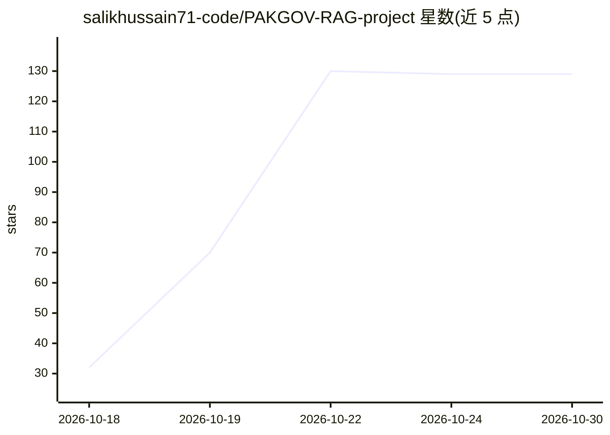

# salikhussain71-code/PAKGOV-RAG-project

⭐ 129 · Python · MIT · 推送 2026-10-28 · [GitHub](https://github.com/salikhussain71-code/PAKGOV-RAG-project) · 个人维护

**巴基斯坦宪法乌尔都语-英语双语 RAG 问答研究项目**

面向巴基斯坦宪法 PDF 文档的双语检索增强生成系统：PDF 提取与分块（6,711 chunk，保留页码与条款元数据）、BM25+FAISS 密集检索经 RRF(k=60) 融合、答案仅基于检索片段生成并附页码引用，证据不足时返回 insufficient evidence 而非猜测。包含 50 题固定评测集（英语/乌尔都语/混合），对比三种检索器并公开失败分析；已扩展至参议院 10 份官方 PDF，2 份扫描件 OCR 尚待处理。提供 Streamlit 演示与评测复现脚本。

## 筛选速览

| 维度 | 判定 | 备注 |
|---|---|---|
| AI 角色 | `ai-native` | 本体是模型或模型工具 |
| 许可风险 | `permissive` | MIT |
| 部署形态 | `library` | 以包/库形式分发 |
| 模型依赖 | — | README 未给出锁定关系 |
| 硬件要求 | — | 无带数字的原话,不猜 |
| 安装摩擦 | `low` | 无编译、无系统依赖或容器化 |
| 成熟度 | — | 结构信号不足 |

## 能力要点

- BM25 + 密集向量经 Reciprocal Rank Fusion (k=60) 混合检索
- 答案仅从检索片段生成并带页码引用，无证据时拒绝作答
- 50 题固定评测集上对比 BM25/密集/混合三种检索器，失败案例全部记录并提交原始输出
- 语料 6,711 chunk，含页码与条款元数据；乌尔都语文本 NFC 规范化

## 适用场景

- 用英语、乌尔都语或混合语言查询巴基斯坦宪法条款
- 复现并检验低资源语言上的检索质量评测结果
- 研究混合检索与引用接地生成在法律文档上的表现

## 场景标签

`RAG` `文档问答` `模型评测` · 领域:评测与运维

## 证据(README 行号)

> L3: **Bilingual (Urdu + English) Retrieval-Augmented-Generation over the Constitution of Pakistan**
> L16: PAKGOV-RAG answers questions about the Constitution of Pakistan in English, Urdu, or a mix of both. It retrieves re
> L65: 5. **Generation:** answers built only from retrieved chunks, with page citations; `insufficient evidence` when supp

## 星数曲线

2026-10-18 32 → 2026-10-30 129（+97）

---
*卡片 v1 · prompt 1.4 · 生成 2026-10-22 · 置信度 high · 依据 README sha `da9b9f333698` · [字段定义](../../DATASET.md)*
