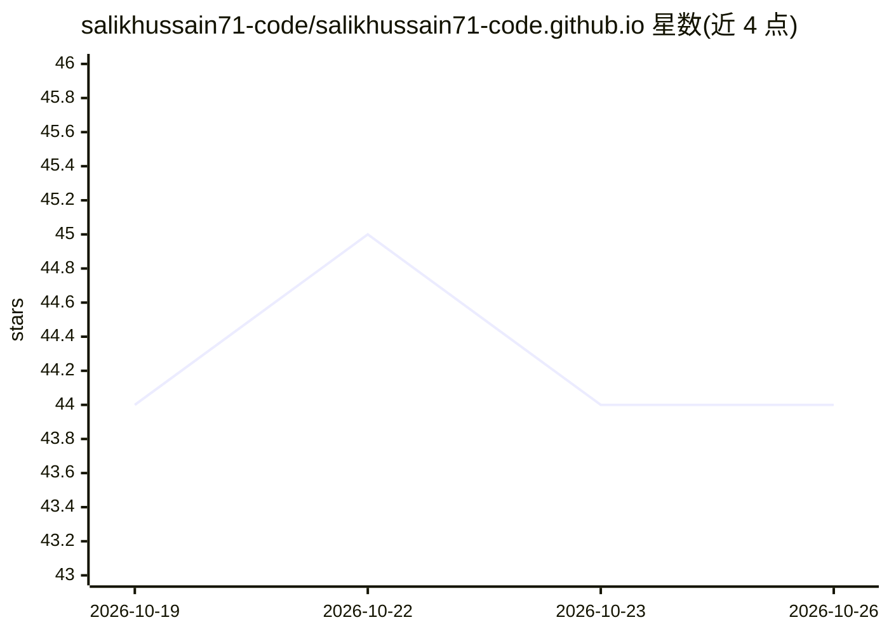

# salikhussain71-code/salikhussain71-code.github.io

⭐ 44 · HTML · 推送 2026-10-13 · [GitHub](https://github.com/salikhussain71-code/salikhussain71-code.github.io) · [官网](https://salikhussain71-code.github.io/) · 个人维护

**个人学术研究主页：追踪 Salik Hussain 的项目与成果**

Salik Hussain 的个人学术与研究档案网站，托管于 GitHub Pages。内容包括其研究方向（低资源乌尔都语 NLP、检索增强生成）、旗舰项目 PAKGOV-RAG（面向巴基斯坦政府文件的乌英双语 RAG 系统）、实习经历、出版物、技能、带凭证 ID 的认证、获奖、项目仓库与按日期记录的工作日志。技术栈为无框架的单文件 HTML5/CSS3 加少量原生 JavaScript，无构建步骤，站点持续更新而非静态快照。

## 筛选速览

| 维度 | 判定 | 备注 |
|---|---|---|
| AI 角色 | `ai-knowledge` | 知识聚合/清单类 |
| 许可风险 | `none` | — |
| 部署形态 | `None` |  |
| 模型依赖 | — | README 未给出锁定关系 |
| 硬件要求 | — | 无带数字的原话,不猜 |
| 安装摩擦 | `low` | 无编译、无系统依赖或容器化 |
| 成熟度 | — | 结构信号不足 |

## 能力要点

- 单文件静态站点，无框架、无构建步骤
- 九类结构化板块覆盖经历、出版物、认证与工作日志
- 认证条目附带可核验的 credential ID
- 面向教授、招生委员会与合作者的实时研究档案

## 适用场景

- 招生委员会或教授查看申请者的研究履历与项目
- 合作者了解 PAKGOV-RAG 等研究工作的入口
- 个人学术身份的长期在线档案维护

## 场景标签

 · 领域:个人学术主页/网站

## 证据(README 行号)

> L5: Personal research and academic profile for **Salik Hussain** — incoming BS Computer Science student at Air Universit
> L11: **Flagship research project:** PAKGOV-RAG — a bilingual Urdu-English retrieval-augmented generation system for Paki

## 星数曲线

2026-10-19 44 → 2026-10-26 44（+0）

---
*卡片 v1 · prompt 1.4 · 生成 2026-10-25 · 置信度 mid · 依据 README sha `a5e28deb2ecb` · [字段定义](../../DATASET.md)*
