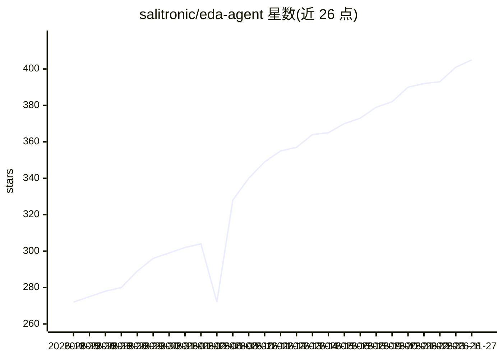

# salitronic/eda-agent

⭐ 405 · Python · Apache-2.0 · 推送 2026-11-26 · [GitHub](https://github.com/salitronic/eda-agent) · [官网](https://salitronic.com/eda-agent) · 个人维护

**让 AI 经 MCP 驱动 Altium Designer 实时会话编辑 EDA 设计的服务器**

MCP 服务器，让 AI 或任意 MCP 兼容客户端连接正在运行的 Altium Designer 会话（KiCad、EasyEDA Pro 为可选后端），在持久 DelphiScript 桥上暴露约 600 个工具，覆盖原理图、PCB、元件库、项目自动化、设计审查、31 项 lint 审计、SPICE 仿真流程与 GUI 驱动。Python 进程经文件 IPC 与 Altium 内轮询脚本通信，改动实时可见；附带 Altium 内状态窗口与本地 Web 审查面板。声明为实验性，部分工具可能使脚本引擎崩溃，使用前需备份设计。

## 筛选速览

| 维度 | 判定 | 备注 |
|---|---|---|
| AI 角色 | `ai-ecosystem` | LLM/agent 周边工具 |
| 许可风险 | `permissive` | Apache-2.0 |
| 部署形态 | `library` | 以包/库形式分发 |
| 模型依赖 | — | README 未给出锁定关系 |
| 硬件要求 | — | 无带数字的原话,不猜 |
| 安装摩擦 | `low` | 无编译、无系统依赖或容器化 |
| 成熟度 | `idea` | |

## 能力要点

- 约 600 个工具覆盖原理图、PCB、库、项目与设计-agent 操作
- design_lint_report 单次 IPC 跑 31 项原理图/PCB 审计检查
- 批量调用机制：单次请求最多 200 项、合并为一个 undo 步骤
- 强制 datasheet 优先纪律，禁止 LLM 编造元件参数

## 适用场景

- 让 Claude Code 从文字规格生成原理图到 Gerber 制造文件
- 对话式设计审查与引导式重构当前打开的工程
- BOM/网络连通性等即席查询与设计 lint 审计

## 场景标签

`GUI 自动化` · 领域:效率与自动化

## 证据(README 行号)

> L3: MCP server that lets an AI (or any MCP-compatible client) **interact with a live Altium Designer session**, with KiC
> L39: - `eda-agent` (Python, launched by your MCP client) sends commands via file-based IPC

## 星数曲线

2026-10-25 272 → 2026-11-27 405（+133）

---
*卡片 v1 · prompt 1.4 · 生成 2026-11-27 · 置信度 high · 依据 README sha `e288349dcd5c` · [字段定义](../../DATASET.md)*
