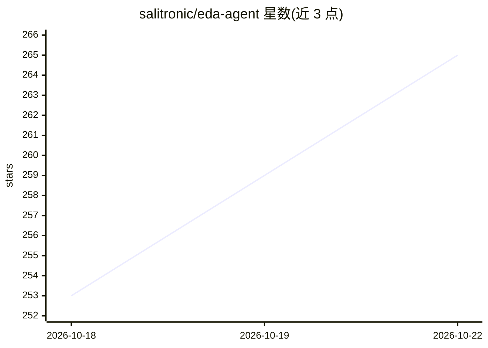

# salitronic/eda-agent

⭐ 267 · Python · Apache-2.0 · 推送 2026-10-22 · [GitHub](https://github.com/salitronic/eda-agent) · [官网](https://salitronic.com/eda-agent) · 个人维护

**MCP 服务器：让 AI 实时操控 Altium Designer 进行电路设计**

面向 MCP 兼容客户端（如 Claude Code）的服务器，通过常驻 DelphiScript 轮询桥以文件 IPC 连接正在运行的 Altium Designer 会话，也可选 KiCad、EasyEDA Pro 作为后端。Altium 后端暴露约 450 个工具，覆盖原理图、PCB、库、项目管理、设计审查与自动布局布线；支持批量原语、31 项 lint 审计、SPICE 仿真工作流、原理图模板绘制与 GUI 驱动。附带 Altium 内浮动状态窗与浏览器端设计审查仪表盘。README 自声明为实验性，部分工具可致 DelphiScript 引擎崩溃，建议先备份设计。

## 筛选速览

| 维度 | 判定 | 备注 |
|---|---|---|
| AI 角色 | `ai-ecosystem` | LLM/agent 周边工具 |
| 许可风险 | `permissive` | Apache-2.0 |
| 部署形态 | `library` | 以包/库形式分发 |
| 模型依赖 | — | README 未给出锁定关系 |
| 硬件要求 | — | 无带数字的原话,不猜 |
| 安装摩擦 | `low` | 无编译、无系统依赖或容器化 |
| 成熟度 | `idea` | |

## 能力要点

- Altium 后端约 450 个 MCP 工具，覆盖原理图/PCB/库/项目/设计 agent 操作
- 批量原语与 design_review_snapshot 将多次 LLM 轮次合并为单次调用
- 31 项 design_lint 审计检查，原理图与 PCB 侧结构化违规清单
- datasheet-first 纪律：禁止 LLM 编造数据手册数值，逐元件附带厂商检索指引

## 适用场景

- 在 Altium 中让 AI 依据数据手册从一句话规格绘制电源等电路
- 对打开的设计做对话式审查、lint 审计与 BOM/网络查询
- 原理图与 PCB 网表交叉核对、SPICE 仿真就绪性检查

## 场景标签

 · 领域:电子设计自动化（EDA）/AI 工具服务

## 证据(README 行号)

> L3: MCP server that lets an AI (or any MCP-compatible client) **interact with a live Altium Designer session**, with KiC
> L32: - `eda-agent` (Python, launched by your MCP client) sends commands via file-based IPC

## 星数曲线

2026-10-18 253 → 2026-10-22 265（+12）

---
*卡片 v1 · prompt 1.4 · 生成 2026-10-22 · 置信度 high · 依据 README sha `7b54cd267cdc` · [字段定义](../../DATASET.md)*
