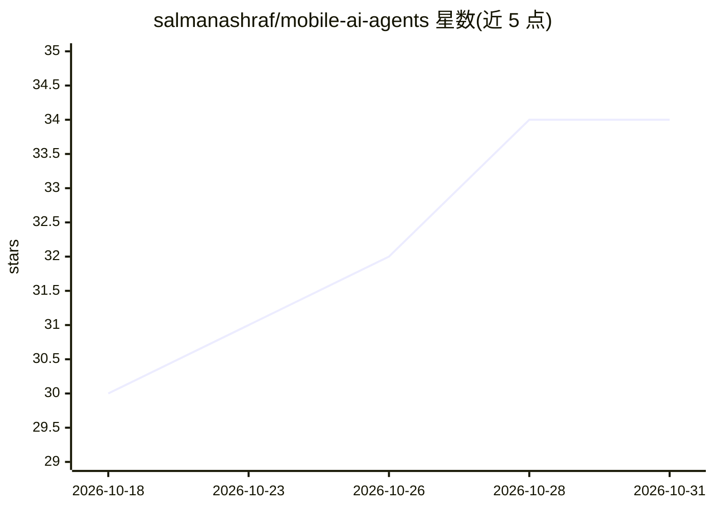

# salmanashraf/mobile-ai-agents

⭐ 34 · JavaScript · MIT · 推送 2026-10-22 · [GitHub](https://github.com/salmanashraf/mobile-ai-agents) · [官网](https://play.google.com/store/apps/details?id=com.sa.outreach.ai) · 个人维护

**面向移动开发者的 AI 代理/技能/工作流工具集（19 代理、57 技能）**

供 Android、iOS、Flutter、React Native、Kotlin Multiplatform、Unity、Unreal 开发者使用的 AI 工程系统：以 npm 包安装到 Claude Code、Cursor、Windsurf、Copilot、Codex 等 AI 编码工具中，提供 19 个具名代理、57 个可组合技能与 17 个端到端工作流。核心机制为 Loop Engineering：规划、实现、架构与代码审计、安全检查、性能分析、UI 验证、设备 QA、发布准备按循环执行，项目上下文通过 Mobile Memory 跨会话保存。另含网站 API 捕获到移动端集成合同的工具。

## 筛选速览

| 维度 | 判定 | 备注 |
|---|---|---|
| AI 角色 | `ai-ecosystem` | LLM/agent 周边工具 |
| 许可风险 | `permissive` | MIT |
| 部署形态 | `library` | 以包/库形式分发 |
| 模型依赖 | — | README 未给出锁定关系 |
| 硬件要求 | — | 无带数字的原话,不猜 |
| 安装摩擦 | `low` | 无编译、无系统依赖或容器化 |
| 成熟度 | — | 结构信号不足 |

## 能力要点

- 19 个具名代理与 57 个可组合技能、17 个端到端工作流
- 覆盖 Android/iOS/Flutter/React Native/KMP/Unity/Unreal 七个平台
- Loop Engineering 循环：规划→实现→审计→安全→UI 验证→QA→发布
- npx 命令生成 PRD/设计/任务/路线图等启动文档

## 适用场景

- 在 AI 编码工具里对 Flutter 或 Android 代码做审查与崩溃分析
- 从想法出发生成 PRD 与任务分解并按循环推进开发
- 发布前执行安全扫描、性能审计与设备 QA
- 把网站 HTTP 交互捕获转成移动端 API 集成依据

## 场景标签

`编码 Agent` `代码审查` · 领域:编码与开发

## 证据(README 行号)

> L16: > AI agents, skills, and Loop Engineering workflows for building, testing, reviewing, and shipping Android, iOS, Fl
> L22: Mobile AI Agents is a ready-to-use AI engineering system for mobile apps, hybrid apps, and games. Instead of learni
> L46: This installs Mobile AI Agents for Claude Code. For Cursor, Windsurf, GitHub Copilot, Codex, platform-only installs

## 星数曲线

2026-10-18 30 → 2026-10-31 34（+4）

---
*卡片 v1 · prompt 1.4 · 生成 2026-10-26 · 置信度 high · 依据 README sha `8c01218a5a89` · [字段定义](../../DATASET.md)*
