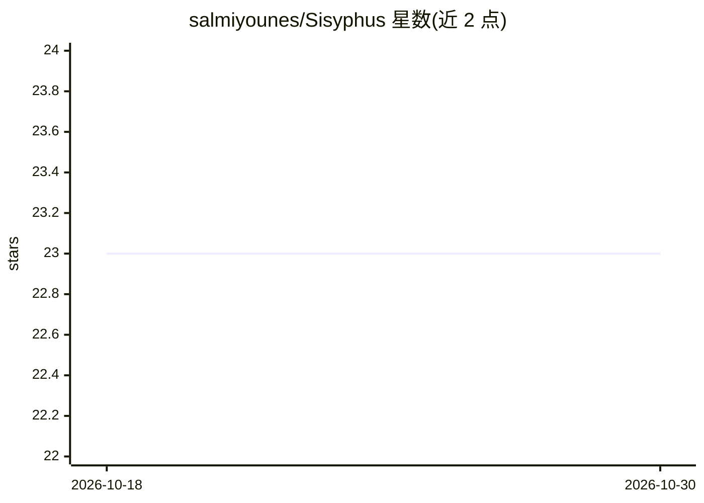

# salmiyounes/Sisyphus

⭐ 23 · C · MIT · 推送 2026-10-24 · [GitHub](https://github.com/salmiyounes/Sisyphus) · [官网](https://lichess.org/@/Sisyphus-engine) · 个人维护

**C 后端的 Python 国际象棋引擎与棋局库**

以 C 实现核心、Python 提供接口的国际象棋引擎与库：位棋盘与 Magic Bitboards 表示，Negamax/PVS/置换表/LMR/空步裁剪等搜索算法，历史/杀手/MVV-LVA 排序与 PeSTO 评估框架。实现 UCI 协议，可接入 CuteChess 等 GUI 或在 Lichess 对弈；也可作库用于走子生成、局面判定、FEN 解析与 perft 测试。需 Python 3.11+ 与 C 编译器，源码克隆后 pip 安装。

## 筛选速览

| 维度 | 判定 | 备注 |
|---|---|---|
| AI 角色 | `ai-enhanced` | 去掉 AI 部分产品仍成立 |
| 许可风险 | `permissive` | MIT |
| 部署形态 | `library` | 以包/库形式分发 |
| 模型依赖 | — | README 未给出锁定关系 |
| 硬件要求 | — | 无带数字的原话,不猜 |
| 安装摩擦 | `medium` | 含编译或系统依赖之一 |
| 成熟度 | — | 结构信号不足 |

## 能力要点

- Bitboards/Magic Bitboards 棋盘表示与完整搜索算法栈（Negamax、PVS、LMR、空步裁剪等）
- UCI 协议实现，可接入主流国际象棋 GUI
- 库形式提供走子生成、将杀/逼和/子力不足判定、FEN 解析、perft 测试

## 适用场景

- 通过 UCI 兼容 GUI 或 Lichess 与引擎对弈
- 在 Python 中做走子生成、局面分析与棋局合法性校验
- 基于引擎库构建自己的国际象棋应用或跑 perft 基准

## 场景标签

 · 领域:游戏/棋类引擎

## 证据(README 行号)

> L29: Sisyphus is a chess engine and library that combines the raw performance of **C** with the flexibility and ease of 
> L223: You can play against Sisyphus using any chess GUI that supports the UCI protocol,

## 星数曲线

2026-10-18 23 → 2026-10-30 23（+0）

---
*卡片 v1 · prompt 1.4 · 生成 2026-10-27 · 置信度 high · 依据 README sha `7d343919b480` · [字段定义](../../DATASET.md)*
