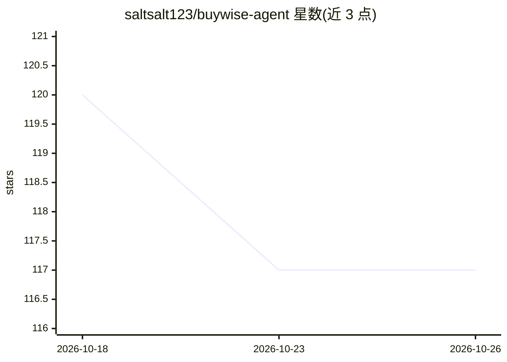

# saltsalt123/buywise-agent

⭐ 117 · Python · MIT · 推送 2026-09-26 · [GitHub](https://github.com/saltsalt123/buywise-agent) · 个人维护

**质保/退货决策的多 agent RAG 助手（MVP）**

基于 LangGraph 的多 agent RAG 应用：用户上传收据、保修卡与退货政策文档，系统经 7 节点工作流（含循环上限）由 4 个 agent 产出带证据支持的回答与行动草案（如退货请求邮件草稿）。验证器计算声明支持率作为置信度，文档矛盾时报 needs_human_review。检索为内存内 IDF 加权词法匹配，嵌入检索未实现，意图分类为关键词匹配。以 FastAPI HTTP API 与 Streamlit UI 提供，本地运行、无外部 API。当前为 v0.1.0 MVP，价格监控等在 Roadmap 后续阶段。

## 筛选速览

| 维度 | 判定 | 备注 |
|---|---|---|
| AI 角色 | `ai-native` | 本体是模型或模型工具 |
| 许可风险 | `permissive` | MIT |
| 部署形态 | `library` | 以包/库形式分发 |
| 模型依赖 | — | README 未给出锁定关系 |
| 硬件要求 | — | 无带数字的原话,不猜 |
| 安装摩擦 | `low` | 无编译、无系统依赖或容器化 |
| 成熟度 | `idea` | |

## 能力要点

- 上传收据/保修卡/政策文档，4 个 agent 产出带证据的回答与行动草案
- 负例评测（5 例）显式验证系统在无证据/矛盾/未实现意图时的拒绝行为
- SAFE_SOURCE_ROOTS 路径白名单，API 在进入工作流前拒绝越界路径
- Streamlit UI 支持一键加载内置示例案例

## 适用场景

- 判断商品是否仍在保修或退货期内并生成行动草案
- 核对收据与商家退货政策之间的矛盾
- 作为多 agent RAG 应用的参考实现学习其评测与防护设计

## 场景标签

`多智能体` `RAG` `文档问答` · 领域:Agent 开发

## 证据(README 行号)

> L13: **A LangGraph multi-agent RAG assistant for warranty/return decisions — local-first, demo-ready.**
> L19: Upload a receipt + warranty card + policy → ask "can I still return/warranty this?" → system runs 4 agents to produ

## 星数曲线

2026-10-18 120 → 2026-10-26 117（-3）

---
*卡片 v1 · prompt 1.4 · 生成 2026-10-23 · 置信度 high · 依据 README sha `f1aa539d024c` · [字段定义](../../DATASET.md)*
