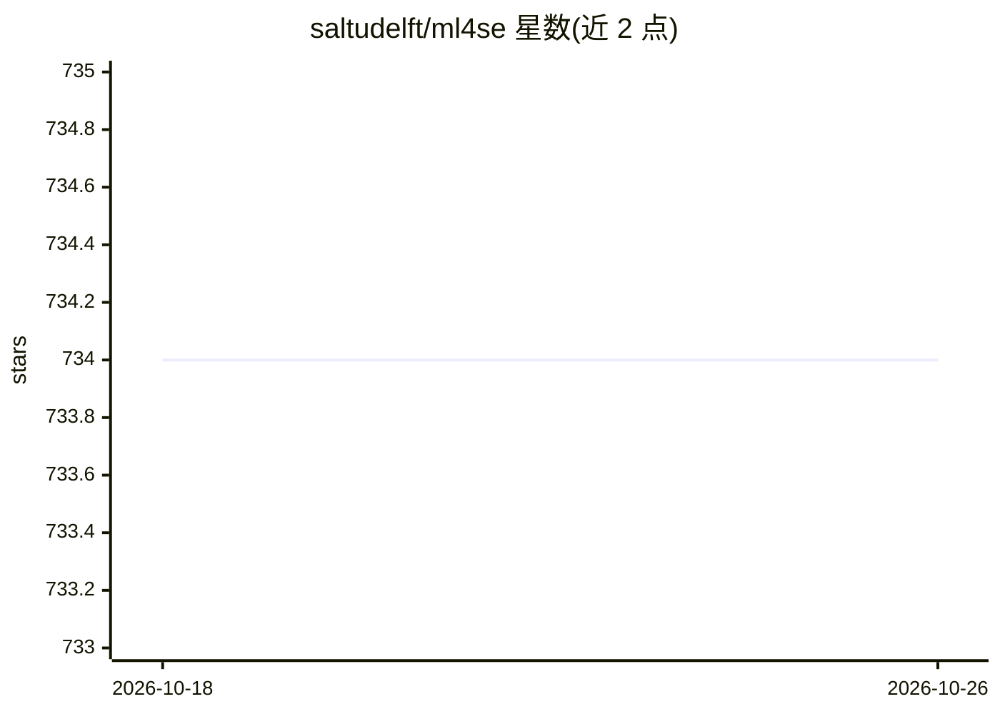

# saltudelft/ml4se

⭐ 734 · 推送 2025-11-06 · [GitHub](https://github.com/saltudelft/ml4se) · [官网](https://ml4se.dev) · 组织维护

**面向软件工程研究的机器学习论文/数据集/工具策展清单**

由代尔夫特理工大学（TU Delft）SERG 维护的 awesome 类清单仓库，收录机器学习应用于软件工程（ML4SE）方向的论文、博士论文、数据集与工具，按类型推断、代码补全、代码生成等研究主题分类组织，每条目附年份、会议/期刊出处与 PDF 链接，部分附代码仓库链接。面向科研人员查找近期论文与最新方法，通过 pull request 接受社区补充。仓库本身为文档清单，不提供可安装运行的软件。

## 筛选速览

| 维度 | 判定 | 备注 |
|---|---|---|
| AI 角色 | `ai-knowledge` | 知识聚合/清单类 |
| 许可风险 | `none` | — |
| 部署形态 | `None` |  |
| 模型依赖 | — | README 未给出锁定关系 |
| 硬件要求 | — | 无带数字的原话,不猜 |
| 安装摩擦 | `low` | 无编译、无系统依赖或容器化 |
| 成熟度 | — | 结构信号不足 |

## 能力要点

- 按研究主题组织的论文清单（类型推断、代码补全、代码生成等）
- 每条目附年份、发表会议/期刊与 PDF 链接
- 部分条目附论文对应的开源代码仓库链接
- 通过 pull request 接受社区补充条目

## 适用场景

- 查找 ML4SE 方向各研究主题的近期论文与 SOTA 方法
- 为论文选题或相关工作调研按主题浏览文献
- 通过条目附带的代码链接获取论文开源实现

## 场景标签

`精选清单` · 领域:学习与行业

## 证据(README 行号)

> L5: This repository contains a curated list of papers, PhD theses, datasets, and tools that are devoted to research on M
> L9: ## Content

## 星数曲线

2026-10-18 734 → 2026-10-26 734（+0）

---
*卡片 v1 · prompt 1.4 · 生成 2026-10-21 · 置信度 high · 依据 README sha `73ac7702e0c7` · [字段定义](../../DATASET.md)*
