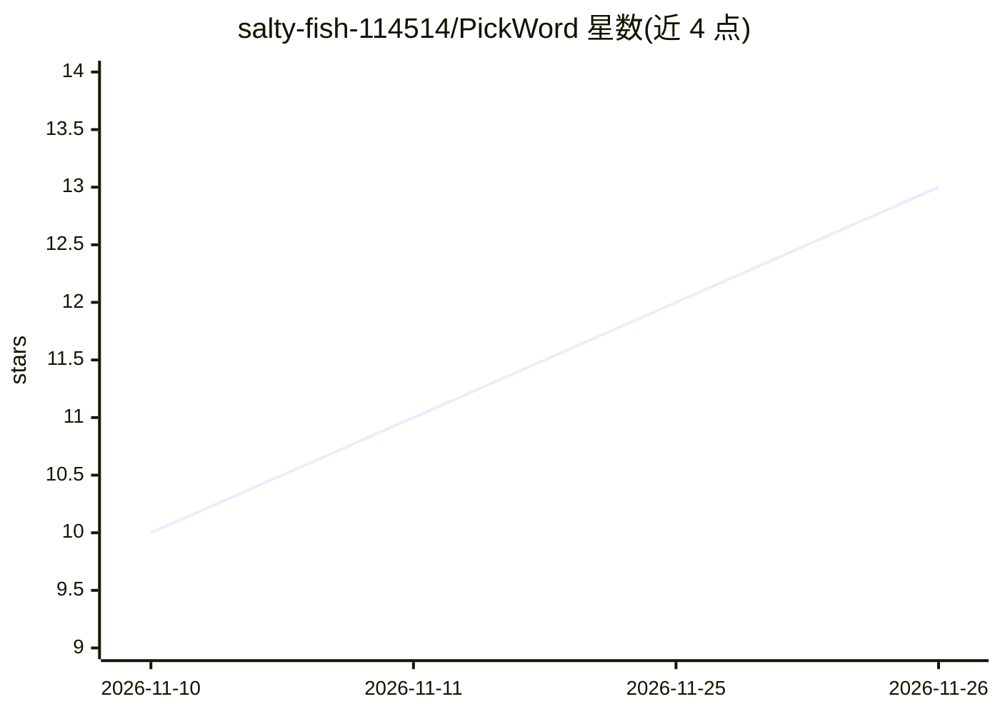

# salty-fish-114514/PickWord

⭐ 13 · TypeScript · Apache-2.0 · 推送 2026-11-11 · [GitHub](https://github.com/salty-fish-114514/PickWord) · [官网](https://github.com/salty-fish-114514/PickWord/releases/latest) · 个人维护 · 中文 README

**面向写作者的 Windows 本地写作软件，以候选词选择方式辅助续写**

基于 Electron 的桌面写作应用：正文由作者书写，本地模型在光标处提供下一个 token 的多个候选，由用户选择或忽略。支持风格参考、大纲与大纲锚点作为可选上下文，短句补全可展开候选为句子；文库按篇管理文稿，支持 .txt/.md/.docx 导入与 TXT 导出。推理通过本机独立运行的 llama-server 进程完成，安装向导检测 CPU/内存/GPU 并推荐下载对应后端；安装包不含模型权重与后端，未签名，当前为测试版本。

## 筛选速览

| 维度 | 判定 | 备注 |
|---|---|---|
| AI 角色 | `ai-native` | 本体是模型或模型工具 |
| 许可风险 | `permissive` | Apache-2.0 |
| 部署形态 | `desktop` | 安装包/桌面程序 |
| 模型依赖 | local-ok | 支持本地模型 |
| 硬件要求 | — | 无带数字的原话,不猜 |
| 安装摩擦 | `medium` | 含编译或系统依赖之一 |
| 成熟度 | `idea` | |

## 能力要点

- 本地模型在光标处给出下一个 token 的多候选，键盘/鼠标选择或概率随机取词
- 正文、风格参考、大纲、大纲锚点分开管理，均可选
- 安装向导检测硬件并推荐 CPU/CUDA/HIP/Vulkan 等运行方式
- 支持指定已有 llama-server.exe 与 .gguf 文件，避免重复下载

## 适用场景

- 写中文小说时由本地模型提供候选词，避免从空白处起笔
- 离线/隐私要求下完成本地推理的辅助写作
- 管理多篇文稿并配套大纲、人物设定等写作资料

## 场景标签

`AI 写作` · 领域:内容生成

## 证据(README 行号)

> L5: > 以「选择题」而不是「填空题」的方式写作：你写下正文，本地模型在光标处提供下一个 token 的候选；选哪个、改不改、什么时候继续写，始终由你决定。
> L94: 写作时，PickWord 请求本地模型预测光标后的下一个 token，并把多个候选展示在光标附近。你可以用键盘或鼠标选择，也可以完全忽略候选，继续自己写。
> L128: 写作时，候选请求发送给本机启动的 `llama-server`，而不是要求你登录一个在线写作服务。首次部署引擎和模型则需要访问相应下载源；选择本地已有文件时，可以避免重复下载。

## 星数曲线

2026-11-10 10 → 2026-11-26 13（+3）

---
*卡片 v1 · prompt 1.4 · 生成 2026-11-18 · 置信度 high · 依据 README sha `ff5619dcd3a5` · [字段定义](../../DATASET.md)*
