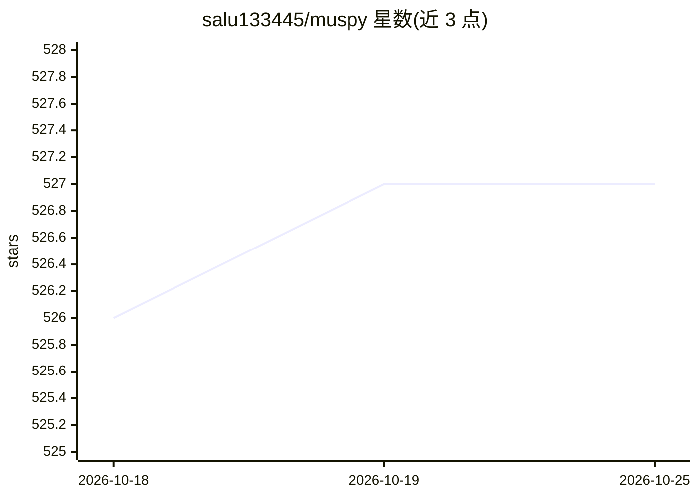

# salu133445/muspy

⭐ 528 · Python · MIT · 推送 2026-03-11 · [GitHub](https://github.com/salu133445/muspy) · [官网](https://salu133445.github.io/muspy/) · 个人维护

**符号音乐生成系统开发的 Python 工具库**

面向符号音乐生成研究的开源 Python 库，覆盖生成流程中的可复用环节：常用数据集管理与下载、MIDI/MusicXML/ABC 等格式读写及与 music21、mido、pretty_midi 等库的接口、音高/事件/钢琴卷帘/音符四种表示实现，以及音频渲染、可视化与客观指标等模型评估工具。提供 PyTorch 与 TensorFlow 接口，通过 pip 安装，配套 ISMIR 2020 论文。库本身不托管数据集，数据使用许可需用户自行确认。

## 筛选速览

| 维度 | 判定 | 备注 |
|---|---|---|
| AI 角色 | `ai-ecosystem` | LLM/agent 周边工具 |
| 许可风险 | `permissive` | MIT |
| 部署形态 | `library` | 以包/库形式分发 |
| 模型依赖 | — | README 未给出锁定关系 |
| 硬件要求 | — | 无带数字的原话,不猜 |
| 安装摩擦 | `low` | 无编译、无系统依赖或容器化 |
| 成熟度 | — | 结构信号不足 |

## 能力要点

- 数据集管理系统，带 PyTorch/TensorFlow 接口
- MIDI/MusicXML/ABC 读写及 music21/mido/pretty_midi/Pypianoroll 接口
- 四种常见音乐表示实现
- 模型评估工具：音频渲染、可视化与客观指标

## 适用场景

- 搭建符号音乐生成系统时复用数据处理与评估流程
- 统一常用音乐数据集的下载与预处理
- 以标准化的表示与指标提高研究可复现性

## 场景标签

 · 领域:音乐生成/音乐信息检索

## 证据(README 行号)

> L8: MusPy is an open source Python library for symbolic music generation. It provides essential tools for developing a m
> L12: - Dataset management system for commonly used datasets with interfaces to PyTorch and TensorFlow.

## 星数曲线

2026-10-18 526 → 2026-10-25 527（+1）

---
*卡片 v1 · prompt 1.4 · 生成 2026-10-21 · 置信度 high · 依据 README sha `e492ace43164` · [字段定义](../../DATASET.md)*
