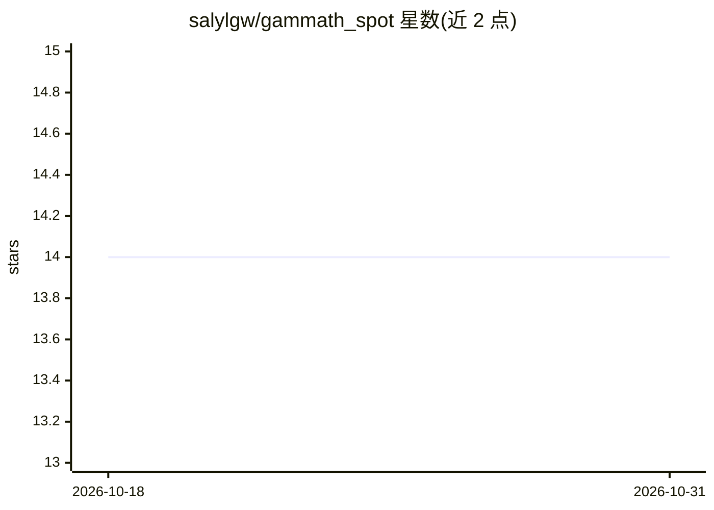

# salylgw/gammath_spot

⭐ 14 · Python · GPL-3.0 · 推送 2026-10-30 · [GitHub](https://github.com/salylgw/gammath_spot) · [官网](https://www.gammathworks.com/stockanalysissoftware) · 个人维护

**面向 DIY 投资者的股票技术分析工具集，输出折扣/溢价评分**

带 GUI 与 CLI 的开源股票技术分析软件：从网络抓取股票数据，用自研算法计算 gScore（-1 至 +1，表示股票以折价或溢价交易的程度），并支持约 5 年期价格预测、移动支撑/阻力线估计、新闻标题情感评分（使用 TensorFlow/scikit-learn/textblob 等依赖）、gScore 历史生成、回测与基于 micro-gScores 的选股筛选。所有工具以 watchlist CSV 为输入，回测策略可在本地自定义。价格预测中的多用途估计器为进行中功能且测试有限；GUI 不支持在 docker 容器内运行。

## 筛选速览

| 维度 | 判定 | 备注 |
|---|---|---|
| AI 角色 | `ai-native` | 本体是模型或模型工具 |
| 许可风险 | `viral` | GPL-3.0 |
| 部署形态 | `self-host` | docker 或自建部署 |
| 模型依赖 | — | README 未给出锁定关系 |
| 硬件要求 | — | 无带数字的原话,不猜 |
| 安装摩擦 | `low` | 无编译、无系统依赖或容器化 |
| 成熟度 | `idea` | |

## 能力要点

- 计算 gScore（-1 至 +1）表示股票折价/溢价程度
- 约 5 年期价格预测与移动支撑/阻力线估计
- 新闻标题情感评分与 gScore/微观 gScore 历史生成
- 可自定义策略的回测与基于 micro-gScores 的选股筛选器

## 适用场景

- 为自己的观察清单计算股票分析评分并生成买卖持有参考
- 对自定策略做约 5 年历史数据回测
- 生成价格预测和支撑/阻力线图表

## 场景标签

`金融量化` · 领域:学习与行业

## 证据(README 行号)

> L4: **S**tock **P**rice-**O**pining **T**oolset is a DIY stock technical analysis software with a Graphical User Interfa
> L10: 2. It provides a `gammath_stocks_analyzer_and_scorer.py` app that analyzes the stock data saved on the local storag
> L11: 3. It provides a `gammath_stocks_pep.py` app that estimates and projects price for an approximately five (5) years 

## 星数曲线

2026-10-18 14 → 2026-10-31 14（+0）

---
*卡片 v1 · prompt 1.4 · 生成 2026-10-31 · 置信度 high · 依据 README sha `94db2799f800` · [字段定义](../../DATASET.md)*
