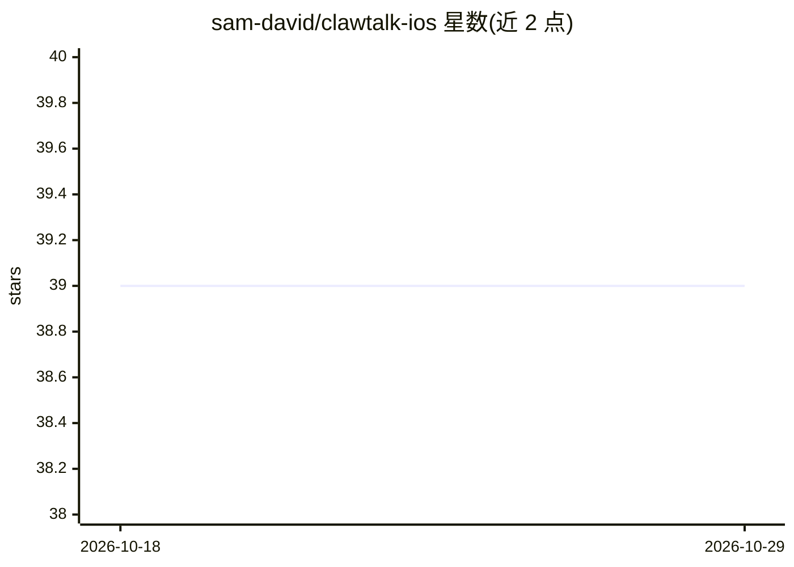

# sam-david/clawtalk-ios

⭐ 39 · Swift · 推送 2026-05-15 · [GitHub](https://github.com/sam-david/clawtalk-ios) · [官网](https://clawtalkapp.com/) · 个人维护

**通过语音/文字与自托管 OpenClaw agent 对话的 iOS 客户端**

原生 iOS 应用，作为自托管 OpenClaw 网关的移动端入口：支持按键/免提语音输入（WhisperKit 端上语音识别）、流式文本回复与 Markdown 渲染、TTS 朗读（ElevenLabs/OpenAI/Apple 可选）、图片发送与多 agent 频道路由，通过 HTTPS 或 WebSocket 连接网关。内置 Tools 仪表盘可直接查看 agent 记忆、会话、浏览器与工作区文件。以 App Store 付费买断（$2.99）或免费源码自行编译分发，需 iOS 17+，部分功能依赖网关侧尚未提供的上游支持。

## 筛选速览

| 维度 | 判定 | 备注 |
|---|---|---|
| AI 角色 | `ai-ecosystem` | LLM/agent 周边工具 |
| 许可风险 | `none` | — |
| 部署形态 | `None` |  |
| 模型依赖 | — | README 未给出锁定关系 |
| 硬件要求 | — | 无带数字的原话,不猜 |
| 安装摩擦 | `medium` | 含编译或系统依赖之一 |
| 成熟度 | — | 结构信号不足 |

## 能力要点

- WhisperKit 端上语音识别，音频不出设备
- 多 agent 频道，每频道独立会话历史
- Tools 仪表盘直读 agent 记忆/会话/浏览器/工作区文件
- 支持 Chat Completions 与 Open Responses 两种 API 模式及可选 WebSocket 模式

## 适用场景

- 在 iPhone 上随时和家里跑的 OpenClaw agent 语音对话
- 给不同 agent（主助手/编码/研究）建独立频道分别聊天
- 通过手机查看 agent 的记忆、会话与浏览器状态

## 场景标签

`语音 Agent` `AI 助手` · 领域:对话与助手

## 证据(README 行号)

> L7:  Push-to-talk or hands-free conversation mode with on-device speech recognition, streaming text responses with markd
> L261: Each channel routes to a specific OpenClaw agent:

## 星数曲线

2026-10-18 39 → 2026-10-29 39（+0）

---
*卡片 v1 · prompt 1.4 · 生成 2026-10-25 · 置信度 high · 依据 README sha `e766d4651113` · [字段定义](../../DATASET.md)*
