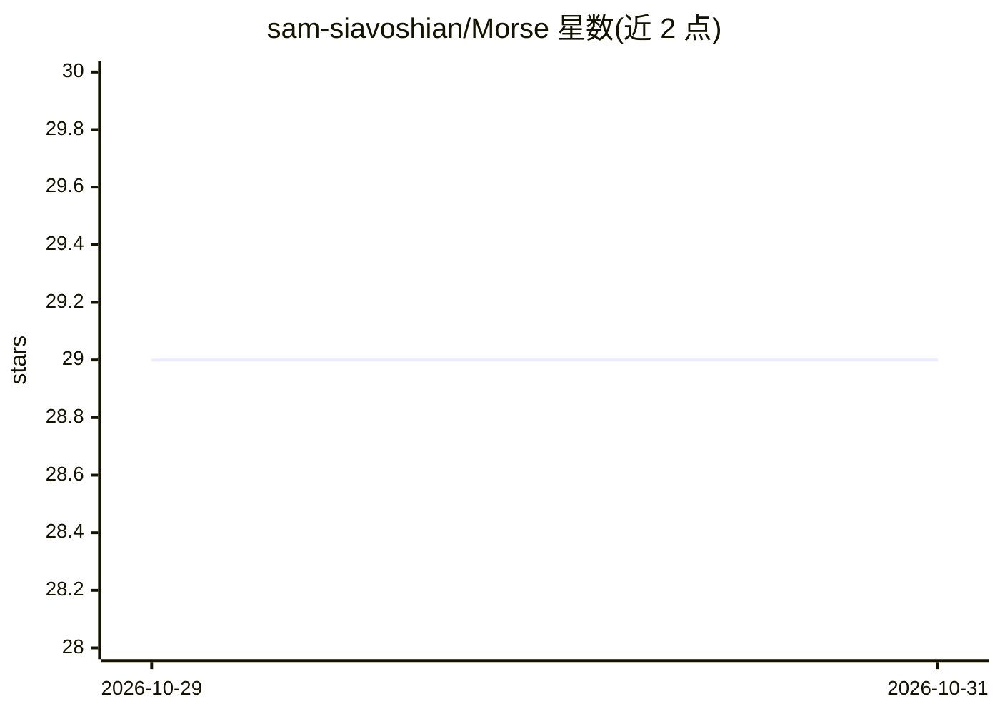

# sam-siavoshian/Morse

⭐ 29 · JavaScript · MIT · 推送 2026-10-28 · [GitHub](https://github.com/sam-siavoshian/Morse) · [官网](https://getmorse.vercel.app/) · 个人维护

**用自然语言修改桌面应用与网页的本地 AI 工具（含闭源应用）**

面向终端用户的桌面应用：通过指向界面元素并用自然语言下达指令，调用用户已有的 AI（Claude Code、Codex 或 Anthropic/OpenAI API key）生成代码，实时修改正在运行的应用或浏览器中的网站；改动可保存为 mod，并在每次应用启动时自动重新应用，可一键关闭或退出还原。无服务器、无账号，修改过程不写入应用文件。支持基于 web 技术的桌面应用与 Chrome/Edge/Brave 等浏览器，不支持 Safari、Firefox 与原生应用。提供 macOS/Windows/Linux 安装包，macOS 版未做 Apple 公证。

## 筛选速览

| 维度 | 判定 | 备注 |
|---|---|---|
| AI 角色 | `ai-native` | 本体是模型或模型工具 |
| 许可风险 | `permissive` | MIT |
| 部署形态 | `desktop` | 安装包/桌面程序 |
| 模型依赖 | locked-api |  |
| 硬件要求 | — | 无带数字的原话,不猜 |
| 安装摩擦 | `low` | 无编译、无系统依赖或容器化 |
| 成熟度 | `idea` | |

## 能力要点

- 指向目标元素后用自然语言让 AI 增删或修改应用功能
- 改动保存为 mod，应用每次启动自动重新应用，可一键关闭还原
- 复用用户已有的 Claude Code / Codex / Anthropic、OpenAI API key，无自有服务器与账号
- 支持跨应用移植功能（Take this / Bring here）

## 适用场景

- 去掉应用中不想要的界面元素（如推荐流、弹窗、付费墙遮罩）
- 给没有某功能的应用补上自己需要的功能或快捷键面板
- 把一个应用里的功能搬到另一个应用中使用

## 场景标签

`编码 Agent` · 领域:编码与开发

## 证据(README 行号)

> L16: The company shipped its version. You don’t have to keep it. Morse inspects the running app and writes code to chang
> L18: Morse has no server and no account. It uses the AI you already have: Claude Code, Codex, or an API key.
> L52: The Morse app opens your app with one extra setting, so it can connect. When you ask for a change, Morse sends your

## 星数曲线

2026-10-29 29 → 2026-10-31 29（+0）

---
*卡片 v1 · prompt 1.4 · 生成 2026-10-28 · 置信度 high · 依据 README sha `1643c52a2149` · [字段定义](../../DATASET.md)*
