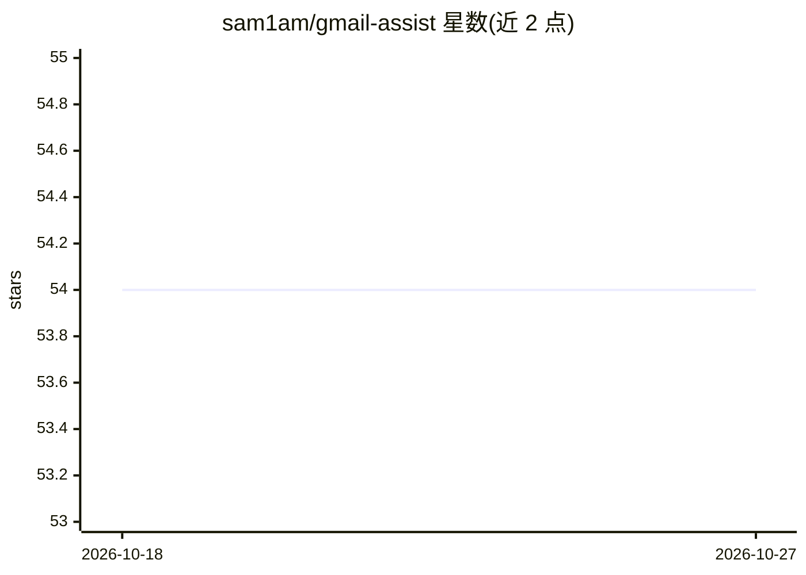

# sam1am/gmail-assist

⭐ 54 · Python · 推送 2026-08-09 · [GitHub](https://github.com/sam1am/gmail-assist) · [官网](http://merrythieves.com) · 个人维护

**用 GPT-3 为 Gmail 未读邮件按重要性打标签的脚本**

Python 脚本，通过 Gmail API 读取未读且未被其标注过的邮件，调用 OpenAI GPT-3（默认 text-davinci-003，可在代码中修改）按重要性分类，并打上 gptJunk/gptLow/gptNormal/gptImportant/gptUrgent 五档标签，邮件本身不作其他修改。需自备 Google Cloud 项目、Gmail API 凭据与 OpenAI API key，并预先在 Gmail 中手工创建上述标签。作者声明为概念验证，可能不符合预期。

## 筛选速览

| 维度 | 判定 | 备注 |
|---|---|---|
| AI 角色 | `ai-native` | 本体是模型或模型工具 |
| 许可风险 | `none` | — |
| 部署形态 | `library` | 以包/库形式分发 |
| 模型依赖 | locked-api |  |
| 硬件要求 | — | 无带数字的原话,不猜 |
| 安装摩擦 | `low` | 无编译、无系统依赖或容器化 |
| 成熟度 | `idea` | |

## 能力要点

- GPT-3 将未读邮件分为 5 档重要性标签
- 标签可用于批量处理或创建其他规则
- prompt.txt 可自定义，模型可在代码中替换
- 支持多账户（删除 token.pickle 后重新认证）

## 适用场景

- 自动给堆积的未读邮件按重要性打标签
- 基于标签对邮件做批量处理或规则过滤

## 场景标签

`工作流自动化` · 领域:效率与自动化

## 证据(README 行号)

> L5: This script uses OpenAI's GPT-3 to classify the importance of unread emails in Gmail and labels them accordingly. Th
> L33: 2. (optional) Modify the model used in openai_api.py (line 25) - text-davinci-0003 by default.

## 星数曲线

2026-10-18 54 → 2026-10-27 54（+0）

---
*卡片 v1 · prompt 1.4 · 生成 2026-10-24 · 置信度 mid · 依据 README sha `61203ef10fed` · [字段定义](../../DATASET.md)*
