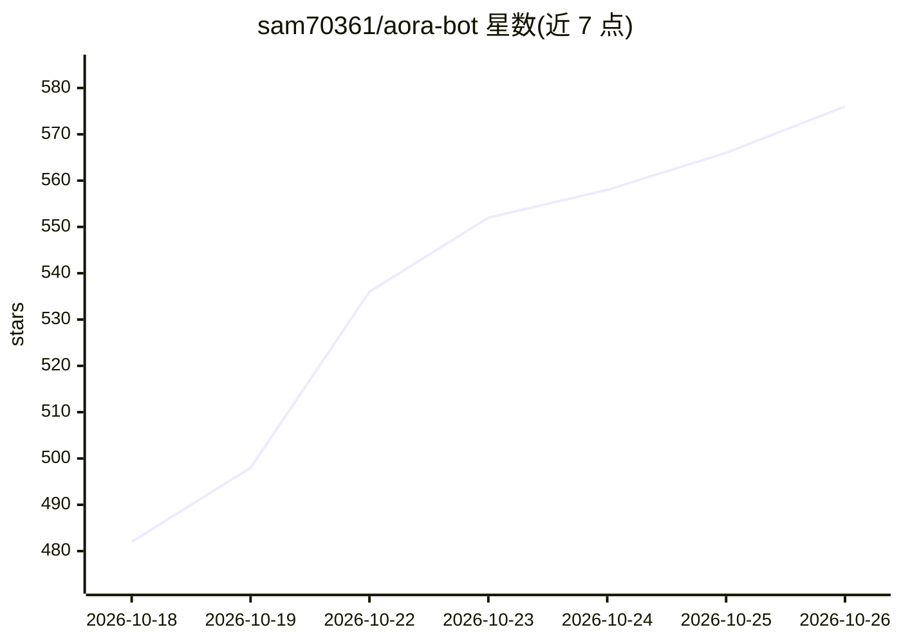

# sam70361/aora-bot

⭐ 576 · JavaScript · NOASSERTION · 推送 2026-08-24 · [GitHub](https://github.com/sam70361/aora-bot) · [官网](https://emotion-balls.vercel.app/) · 个人维护 · 中文 README

**给 AI 助手的 SVG 表情引擎：32 种表情按 emotionId 切换**

纯 SVG + 原生 JavaScript 实现的表情引擎，面向聊天机器人、桌面宠物、悬浮助手等 AI 助手场景。AI 侧只需输出含 emotionId 的 JSON 交给 handleAIMessage，小球即切换对应表情；协议含未知 ID 回退与 error 事件。内置 32 种状态表情（生命周期/情绪/代理工作状态）、3 种身体形态、配置驱动的眼环-动画原语-关键帧体系，支持运行时注册自定义表情与配置导入导出。仓库含三角色同台展示馆与 mood-mates 原创角色子项目，双许可（非商业免费、商业需授权），球形角色视觉形象禁商用。无构建步骤，引入脚本或静态服务器即可运行。

## 筛选速览

| 维度 | 判定 | 备注 |
|---|---|---|
| AI 角色 | `ai-enhanced` | 去掉 AI 部分产品仍成立 |
| 许可风险 | `none` | NOASSERTION |
| 部署形态 | `None` |  |
| 模型依赖 | — | README 未给出锁定关系 |
| 硬件要求 | — | 无带数字的原话,不猜 |
| 安装摩擦 | `low` | 无编译、无系统依赖或容器化 |
| 成熟度 | — | 结构信号不足 |

## 能力要点

- 32 种表情按分段式 emotionId（00-49 + 自定义 50+）切换，编号永不重排
- AI 对接协议：handleAIMessage 接受对象/JSON 字符串，异常自动回退待机并触发 error 事件
- 零依赖 HTML+SVG+原生 JS，无构建步骤，可直接迁移 Electron 悬浮窗
- 表情为纯数据配置，支持运行时注册、导入导出全部配置

## 适用场景

- 给聊天机器人或 AI 助手增加可视化情绪表达层
- Electron 桌面宠物/悬浮窗显示思考、检索、任务完成等代理状态
- 按统一设计规范扩展自定义表情

## 场景标签

 · 领域:前端 UI/AI 助手界面

## 证据(README 行号)

> L24: Emotion Ball 是一套面向 AI 助手的表情引擎:32 种状态表情全部由纯 SVG 与原生 JavaScript 实时驱动,零框架、零图片资源。AI 侧只需输出一个 `emotionId`,即可切换到对应表情,可直接用作
> L87: AI 只需输出一段 JSON,交给 `handleAIMessage`(接受对象或字符串):
> L90: ball.handleAIMessage('{"emotionId":"30","tips":"正在思考用户问题"}');

## 星数曲线

2026-10-18 482 → 2026-10-26 576（+94）

---
*卡片 v1 · prompt 1.4 · 生成 2026-10-21 · 置信度 high · 依据 README sha `07e8c9ed25c8` · [字段定义](../../DATASET.md)*
