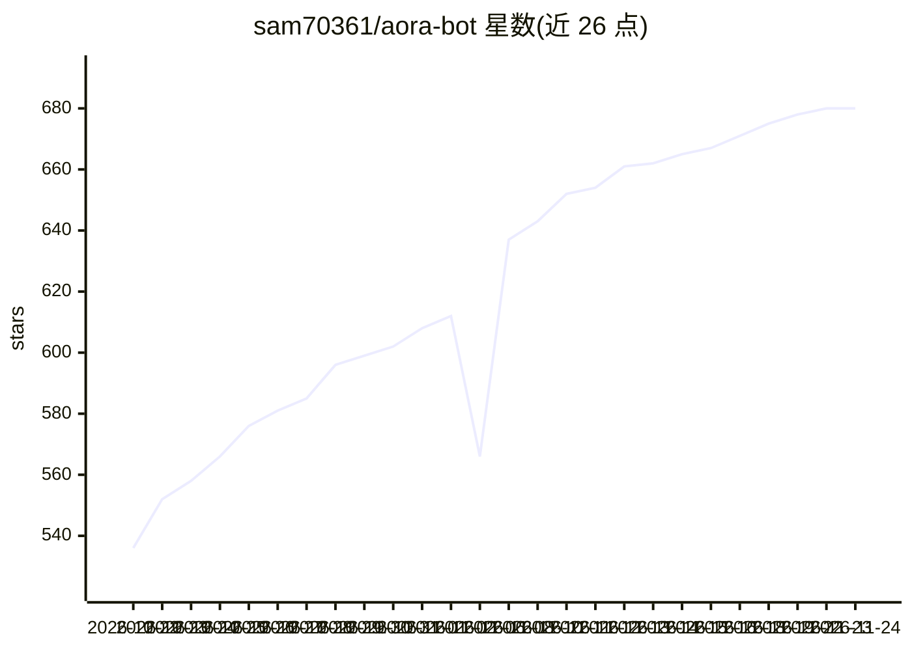

# sam70361/aora-bot

⭐ 680 · TypeScript · NOASSERTION · 推送 2026-11-08 · [GitHub](https://github.com/sam70361/aora-bot) · [官网](https://aora-bot.vercel.app) · 个人维护 · 中文 README

**面向前端开发者的代码绘制网页卡通角色/头像引擎**

用 TypeScript 实现的程序化角色引擎：角色、表情与动画均由代码生成 SVG（requestAnimationFrame 驱动），无雪碧图与 Lottie 文件。提供 71 个基础角色、16 种脸、44 种动画状态、三种画风，另有 7 个节日主题共 122 个角色，按需加载。以四个 npm 包分发：引擎核心（不依赖 React/DOM）、Web Component、React 组件层与产品面组件，包含头像编辑器、聊天活动指示器、HUD 表盘及面向 AI 智能体的数字情绪协议，并支持头像图片接口。原 Emotion Ball 表情馆升级而来，采用分级授权。

## 筛选速览

| 维度 | 判定 | 备注 |
|---|---|---|
| AI 角色 | `ai-enhanced` | 去掉 AI 部分产品仍成立 |
| 许可风险 | `none` | NOASSERTION |
| 部署形态 | `library` | 以包/库形式分发 |
| 模型依赖 | — | README 未给出锁定关系 |
| 硬件要求 | — | 无带数字的原话,不猜 |
| 安装摩擦 | `low` | 无编译、无系统依赖或容器化 |
| 成熟度 | — | 结构信号不足 |

## 能力要点

- 71 个角色、44 种动画状态、16 种脸、三种画风（vector/pixel/kaomoji），全部由代码绘制
- 四种接入方式：npm 安装的 React 组件、Web Component 一行 script、头像图片接口、独立引擎包
- 数字情绪协议接受 { emotionId } 消息，用于 AI 智能体的状态表达
- 7 个节日/季节主题共 122 个角色，独立入口按需加载不影响主包体积

## 适用场景

- 给网页产品加卡通吉祥物、表情反馈与头像系统
- 为 AI 助手/聊天机器人界面呈现情绪化的角色状态
- 给智能硬件小屏幕与桌面设备加表情界面
- 设计师批量生成头像与吉祥物素材

## 场景标签

 · 领域:前端 UI/角色动画引擎

## 证据(README 行号)

> L11: 一个完全由代码绘制的卡通角色。没有雪碧图，没有 Lottie 文件：每个身体都是代码里的一条轮廓
> L30: 形状与墨色选择器、带图片裁切的头像编辑器、群组头像堆叠、聊天活动指示器、给 AI 智能体用的
> L139: Aora Bot 面向前端、AI 与硬件开发者，也被设计师用来制作头像和吉祥物。赞助商的标志会展示在这里和打赏页面上。

## 星数曲线

2026-10-22 536 → 2026-11-24 680（+144）

---
*卡片 v1 · prompt 1.4 · 生成 2026-11-24 · 置信度 high · 依据 README sha `fe0292b495a4` · [字段定义](../../DATASET.md)*
