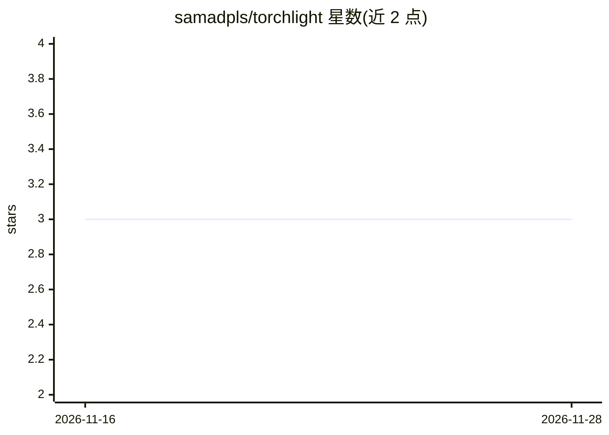

# samadpls/torchlight

⭐ 3 · Python · Apache-2.0 · 推送 2026-11-01 · [GitHub](https://github.com/samadpls/torchlight) · [官网](https://huggingface.co/datasets/samadpls/torchlight-threads) · 个人维护

**面向 PyTorch 开发者的答疑小模型及数据/训练/评测全流程**

项目包含三部分：从 22,484 个 PyTorch 论坛帖构建的 6,841 条已解决问答数据集（torchlight-threads）、两个微调模型（Qwen3-8B 与 Phi-4-mini，均以 LoRA/QLoRA 训练并发布完整模型、LoRA 适配器与 GGUF），以及基于 LLM-as-judge 的评测流程。模型经系统提示词训练，问题信息充分时给出具体修复，不足时追问代码或报错。可经 transformers、llama.cpp 或 Ollama 运行，复现使用 uv 同步依赖。

## 筛选速览

| 维度 | 判定 | 备注 |
|---|---|---|
| AI 角色 | `ai-native` | 本体是模型或模型工具 |
| 许可风险 | `permissive` | Apache-2.0 |
| 部署形态 | `None` |  |
| 模型依赖 | local-ok | 支持本地模型 |
| 硬件要求 | — | 无带数字的原话,不猜 |
| 安装摩擦 | `low` | 无编译、无系统依赖或容器化 |
| 成熟度 | — | 结构信号不足 |

## 能力要点

- 6,841 条论坛问答数据集，每条配被采纳的解答，按时间切分训练/验证/测试
- 两个 LoRA 微调模型分别发布完整模型、适配器与 GGUF 三种格式
- 评测以 Claude Opus 5.5 作裁判对比基座模型，测试题晚于模型训练数据
- 微调后错误答案比例减半（31%→15%、33%→16%，p<0.001）

## 适用场景

- 在本地笔记本上运行小模型解答 PyTorch 使用问题
- 复现论坛数据抓取、清洗与 SFT 训练流程
- 参考其评测方法对比微调前后与基座模型表现

## 场景标签

`网页抓取` `微调` `模型评测` · 领域:效率与自动化

## 证据(README 行号)

> L10:  A PyTorch helper trained on the answers that solved real forum threads.
> L13: torchlight is a set of small models that help with PyTorch questions. They learned from PyTorch forum threads, each
> L18: |2|Models|Qwen3-8B fine-tuned on a free Kaggle GPU, and Phi-4-mini (3.8B) fine-tuned on a MacBook|`torchlight-qwen3

## 星数曲线

2026-11-16 3 → 2026-11-28 3（+0）

---
*卡片 v1 · prompt 1.4 · 生成 2026-11-21 · 置信度 high · 依据 README sha `3c85066593f9` · [字段定义](../../DATASET.md)*
