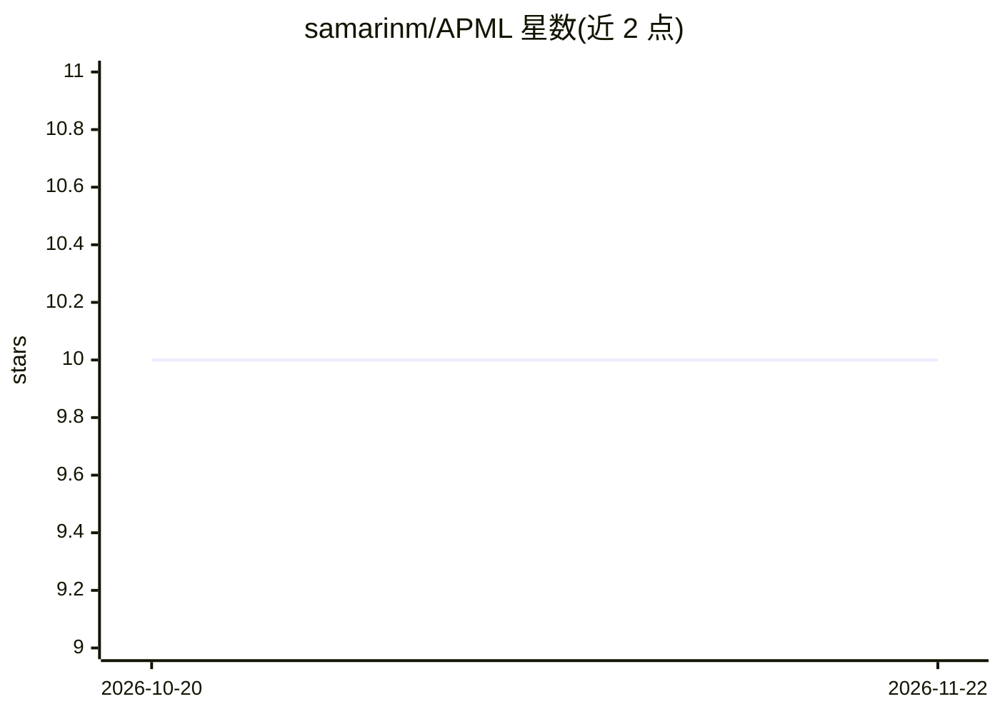

# samarinm/APML

⭐ 10 · Jupyter Notebook · 推送 2026-05-20 · [GitHub](https://github.com/samarinm/APML) · 组织维护

**巴塞尔大学高级 Python 与机器学习课程材料集**

巴塞尔大学 Transferable Skills 项目的高级 Python 编程与机器学习课程（2026 年 5 月）材料仓库，包含 Jupyter notebook 课程内容与作业。提供 Renku lab 在线一键运行 notebook 的免安装入口；本地使用推荐通过 Anaconda 安装 Python，并给出用 mamba 依 environment.yml 创建 APML 课程环境、激活后启动 Jupyter Lab 的步骤。

## 筛选速览

| 维度 | 判定 | 备注 |
|---|---|---|
| AI 角色 | `ai-knowledge` | 知识聚合/清单类 |
| 许可风险 | `none` | — |
| 部署形态 | `None` |  |
| 模型依赖 | — | README 未给出锁定关系 |
| 硬件要求 | — | 无带数字的原话,不猜 |
| 安装摩擦 | `low` | 无编译、无系统依赖或容器化 |
| 成熟度 | — | 结构信号不足 |

## 能力要点

- 提供 Renku lab 在线运行 notebook，无需本地安装
- 附 environment.yml 一键创建课程 Python 环境
- 含课程材料按周更新与作业发布的时间表

## 适用场景

- 参加巴塞尔大学该门课程的学习材料获取
- 在线或本地运行课程 Jupyter notebook 做练习
- 按课程日程下载更新的讲义与作业

## 场景标签

`教程课程` · 领域:学习与行业

## 证据(README 行号)

> L1: # Advanced Python and Machine Learning
> L3: Find here the course material for the advanced course on Python programming and Machine Learning (11th, 12th, 18th, 
> L5: Do you want to immediately dive into the course material? Check out Renku lab and click "Launch" to run the notebook

## 星数曲线

2026-10-20 10 → 2026-11-22 10（+0）

---
*卡片 v1 · prompt 1.4 · 生成 2026-11-19 · 置信度 high · 依据 README sha `f2cbabd90862` · [字段定义](../../DATASET.md)*
