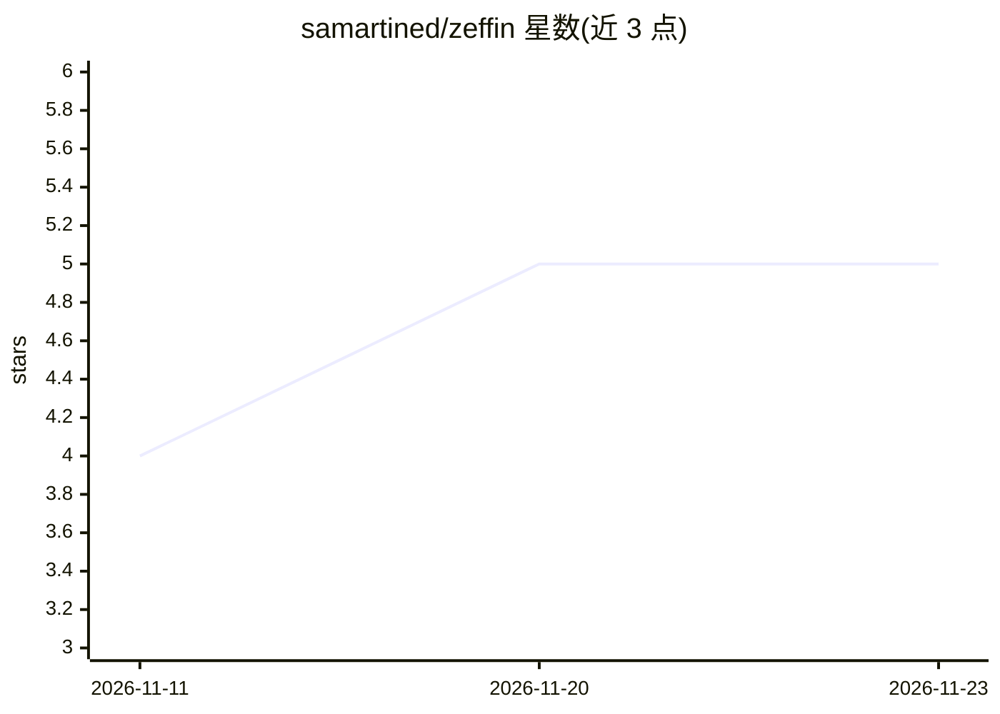

# samartined/zeffin

⭐ 5 · Python · AGPL-3.0 · 推送 2026-11-11 · [GitHub](https://github.com/samartined/zeffin) · [官网](https://github.com/samartined/zeffin/blob/main/docs/guide/README.md) · 个人维护

**让 AI agent 通过安卓手机远程操控 Flipper Zero**

Zeffin 在自托管 Linux 服务器上运行 agent，并把 Flipper Zero 作为工具接入：读取屏幕、模拟按键、读写文件、打开应用；手机上的安卓应用充当蓝牙中继，经 Tailscale 私有网络与服务器通信，提供实时屏幕镜像、审计日志、Pause（只读）与 Stop 控制。服务器端以 git clone 加 install.sh 脚本安装，手机端从 Releases 下载 APK 配对，不支持 Google Play 渠道。要求 Flipper Zero、Android 14+、Python 3.11+ 服务器与 Tailscale。

## 筛选速览

| 维度 | 判定 | 备注 |
|---|---|---|
| AI 角色 | `ai-ecosystem` | LLM/agent 周边工具 |
| 许可风险 | `viral` | AGPL-3.0 |
| 部署形态 | `None` |  |
| 模型依赖 | — | README 未给出锁定关系 |
| 硬件要求 | — | 无带数字的原话,不猜 |
| 安装摩擦 | `low` | 无编译、无系统依赖或容器化 |
| 成熟度 | — | 结构信号不足 |

## 能力要点

- agent 以看屏-按键-再看屏的方式操控 Flipper 菜单与应用
- 支持 Claude Code 与 OpenCode 两种 agent，按会话选择
- 全部流量走 Tailscale tailnet，配对采用 pin key 与六位数确认
- 提供实时屏幕、审计日志与只读 Pause 模式

## 适用场景

- 远程查看并操作我的 Flipper Zero 上保存的红外遥控
- 让 agent 帮我列出并整理 Flipper 上的文件
- 通过手机实时观察 agent 的每一步操作并随时暂停

## 场景标签

`GUI 自动化` · 领域:效率与自动化

## 证据(README 行号)

> L10: Zeffin runs an agent on a Linux server of your own and gives it the Flipper Zero as a tool: it sees the screen, pre
> L20:     server <-- "one turn per message" --> agent["The agent (Claude Code or OpenCode)"]
> L24: The phone forwards the Flipper's link to your server, which gives the agent the Flipper's tools and serves the app 

## 星数曲线

2026-11-11 4 → 2026-11-23 5（+1）

---
*卡片 v1 · prompt 1.4 · 生成 2026-11-21 · 置信度 high · 依据 README sha `28848e727a75` · [字段定义](../../DATASET.md)*
