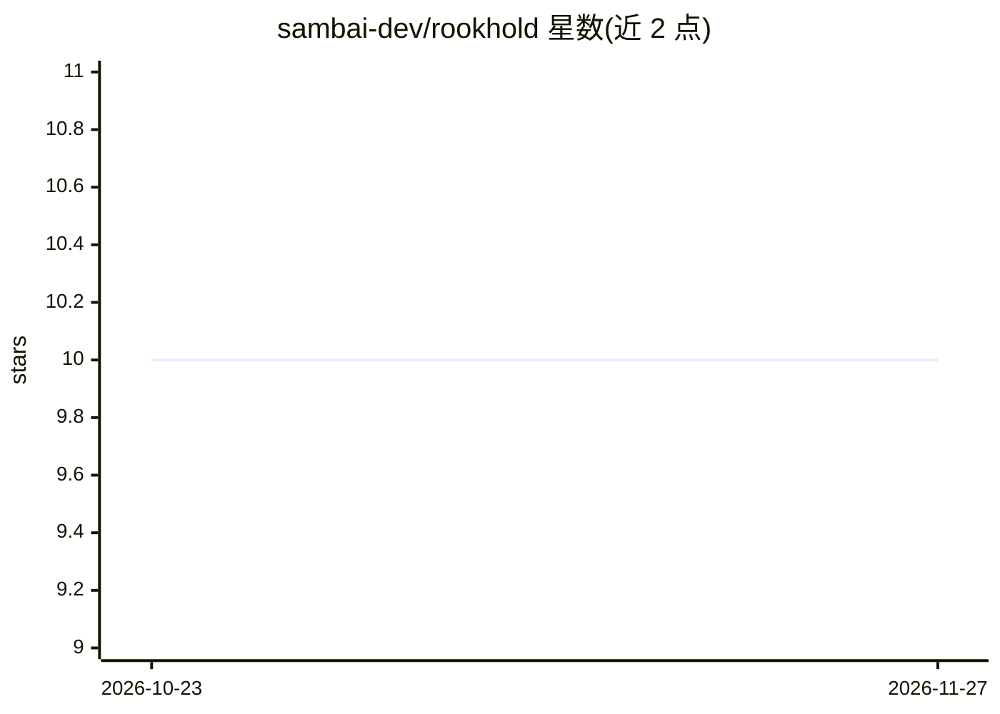

# sambai-dev/rookhold

⭐ 10 · Rust · MIT · 推送 2026-11-17 · [GitHub](https://github.com/sambai-dev/rookhold) · [官网](https://rookhold.pages.dev/) · 个人维护

**给 agent/评估器提供带硬限制与可验证回执的短时代码执行运行器**

Rookhold 是一个有界作业运行器，用于执行短期 Python、Node、Bash 代码并保留可验证回执。面向接收生成代码但不应让其访问宿主机的应用、agent、评估器与自动化。每个作业经认证与准入策略、施加服务端控制的时间/内存/进程/文件/输出限制、经 gVisor（生产配置限 Linux x86_64）隔离执行，并记录事件哈希链与回执。提供 app bundle、Python/TypeScript SDK、独立客户端与 MCP 适配器；本地无端点模式无沙箱边界，仅限可信代码。

## 筛选速览

| 维度 | 判定 | 备注 |
|---|---|---|
| AI 角色 | `ai-ecosystem` | LLM/agent 周边工具 |
| 许可风险 | `permissive` | MIT |
| 部署形态 | `desktop` | 安装包/桌面程序 |
| 模型依赖 | — | README 未给出锁定关系 |
| 硬件要求 | — | 无带数字的原话,不猜 |
| 安装摩擦 | `low` | 无编译、无系统依赖或容器化 |
| 成熟度 | `idea` | |

## 能力要点

- 服务端强制时间、内存、进程、文件与输出限制，并生成可验证回执
- 生产配置使用 gVisor runsc、cgroup v2 与专用 Linux x86_64 VM 隔离
- 提供 Python/TypeScript SDK、独立客户端与 MCP 适配器（Claude Code/OpenCode/Hermes 接入模板）
- SHA-256 事件哈希链与 attestation_outbox 签名留存执行证据

## 适用场景

- 在 agent 进程外运行 LLM 生成的代码
- 对隐藏测试评估代码并保留评估记录
- 让模型只能经由受控 API 边界执行任务

## 场景标签

`Agent 框架` · 领域:Agent 开发

## 证据(README 行号)

> L14: Rookhold is for applications, agents, evaluators, graders, and automations that
> L122: `mcp-server` argument in Claude Code, OpenCode, Hermes, or another MCP host.
> L146: 3. runs the job using the configured execution provider;

## 星数曲线

2026-10-23 10 → 2026-11-27 10（+0）

---
*卡片 v1 · prompt 1.4 · 生成 2026-11-19 · 置信度 high · 依据 README sha `15fa1ef06786` · [字段定义](../../DATASET.md)*
