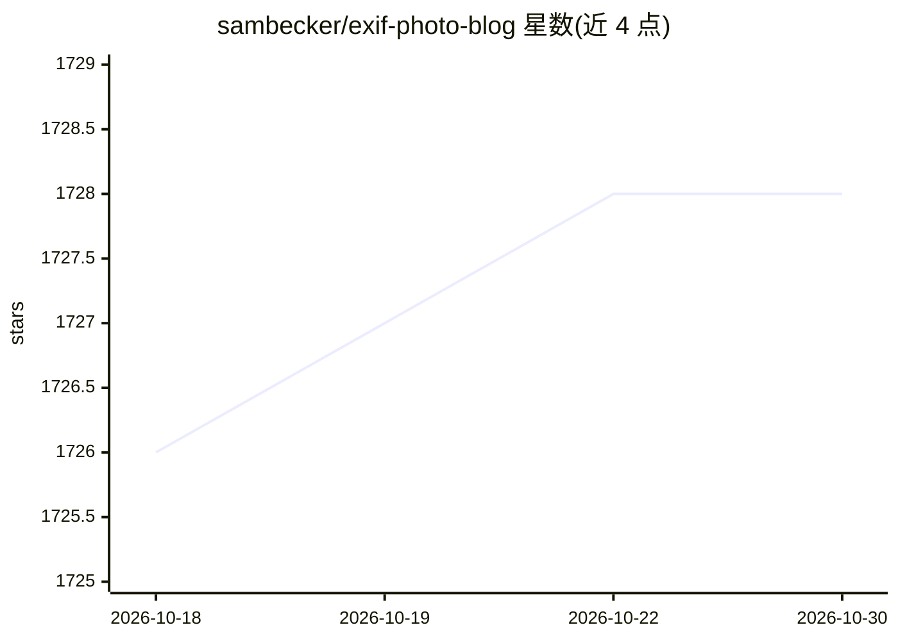

# sambecker/exif-photo-blog

⭐ 1,728 · TypeScript · 推送 2026-10-29 · [GitHub](https://github.com/sambecker/exif-photo-blog) · [官网](https://photos.sambecker.com) · 个人维护

**基于 Next.js 的照片博客，展示每张照片的 EXIF 相机参数**

面向摄影爱好者/个人摄影师的相册博客模板：上传照片时自动提取 EXIF（光圈、快门、ISO 等），按标签、相机、镜头、胶片模拟等分类组织，支持认证后台、无限滚动、OG 图生成、CMD-K 搜索与 RSS/JSON feed。可选启用 AI 生成照片文字描述与色彩分析（通过 Vercel AI Gateway 或 OpenAI 兼容端点）。部署主路径为 Vercel（Vercel Postgres + Blob），也可用 Cloudflare R2/AWS S3/MinIO 作为存储适配器，本地开发需 pnpm 与 Vercel CLI。

## 筛选速览

| 维度 | 判定 | 备注 |
|---|---|---|
| AI 角色 | `ai-enhanced` | 去掉 AI 部分产品仍成立 |
| 许可风险 | `none` | — |
| 部署形态 | `library` | 以包/库形式分发 |
| 模型依赖 | — | README 未给出锁定关系 |
| 硬件要求 | — | 无带数字的原话,不猜 |
| 安装摩擦 | `low` | 无编译、无系统依赖或容器化 |
| 成熟度 | — | 结构信号不足 |

## 能力要点

- 上传时自动提取 EXIF 相机参数并展示
- AI 生成照片标题/描述/标签与色彩分析（可选用）
- 四种存储适配器：Vercel Blob、Cloudflare R2、AWS S3、MinIO
- 标签/相机/镜头/胶片模拟等多维分类与色彩排序

## 适用场景

- 搭建展示拍摄参数的个人摄影博客
- 让 AI 自动为上传的照片生成标题、描述与标签
- 按相机、镜头、胶片配方整理和浏览照片

## 场景标签

`多模态` · 领域:感知与多模态

## 证据(README 行号)

> L21: - Photo upload with EXIF extraction
> L27: - AI-generated text descriptions
> L103: To enable AI-powered color analysis and text descriptions of photos, configure a provider. Vercel AI Gateway is th

## 星数曲线

2026-10-18 1,726 → 2026-10-30 1,728（+2）

---
*卡片 v1 · prompt 1.4 · 生成 2026-10-21 · 置信度 mid · 依据 README sha `20fcc3e9633c` · [字段定义](../../DATASET.md)*
