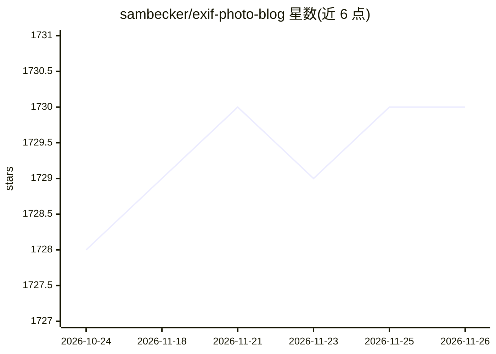

# sambecker/exif-photo-blog

⭐ 1,730 · TypeScript · 推送 2026-11-23 · [GitHub](https://github.com/sambecker/exif-photo-blog) · [官网](https://photos.sambecker.com) · 个人维护

**摄影师自托管照片博客模板，每张图展示 EXIF 参数**

基于 Next.js 的照片博客模板，可一键部署到 Vercel。核心功能包括照片上传时提取并展示 EXIF 拍摄参数（光圈、快门、ISO）、按标签组织、无限滚动、内置鉴权、自动生成 OG 图片、CMD-K 照片搜索、RSS/JSON 订阅。支持 Fujifilm 胶片模拟与 OM SYSTEM 配方分类画廊。可选启用 AI 生成照片标题/描述/语义标签与颜色分析，需配置 Vercel AI Gateway 或 OpenAI 兼容端点；本地开发依赖 Vercel CLI。

## 筛选速览

| 维度 | 判定 | 备注 |
|---|---|---|
| AI 角色 | `ai-enhanced` | 去掉 AI 部分产品仍成立 |
| 许可风险 | `none` | — |
| 部署形态 | `library` | 以包/库形式分发 |
| 模型依赖 | — | README 未给出锁定关系 |
| 硬件要求 | — | 无带数字的原话,不猜 |
| 安装摩擦 | `low` | 无编译、无系统依赖或容器化 |
| 成熟度 | — | 结构信号不足 |

## 能力要点

- 上传时提取 EXIF 并按相机/镜头/焦距等类别组织
- AI 生成标题、描述、标签与颜色分析（需配置 provider）
- 自动 OG 图片生成与 CMD-K 照片搜索
- 支持 Fujifilm 胶片模拟与 OM SYSTEM 配方画廊

## 适用场景

- 搭建展示拍摄参数的个人摄影博客
- 托管作品集并自动生成分享预览图
- 按胶片模拟或相机配方组织照片集

## 场景标签

`AI 写作` · 领域:内容生成

## 证据(README 行号)

> L1: # 📷 `EXIF` Photo Blog
> L32: - AI-generated text descriptions
> L109: To enable AI-powered color analysis and text descriptions of photos, configure a provider. Vercel AI Gateway is th

## 星数曲线

2026-10-24 1,728 → 2026-11-26 1,730（+2）

---
*卡片 v1 · prompt 1.4 · 生成 2026-11-24 · 置信度 high · 依据 README sha `b2a75bb123c4` · [字段定义](../../DATASET.md)*
