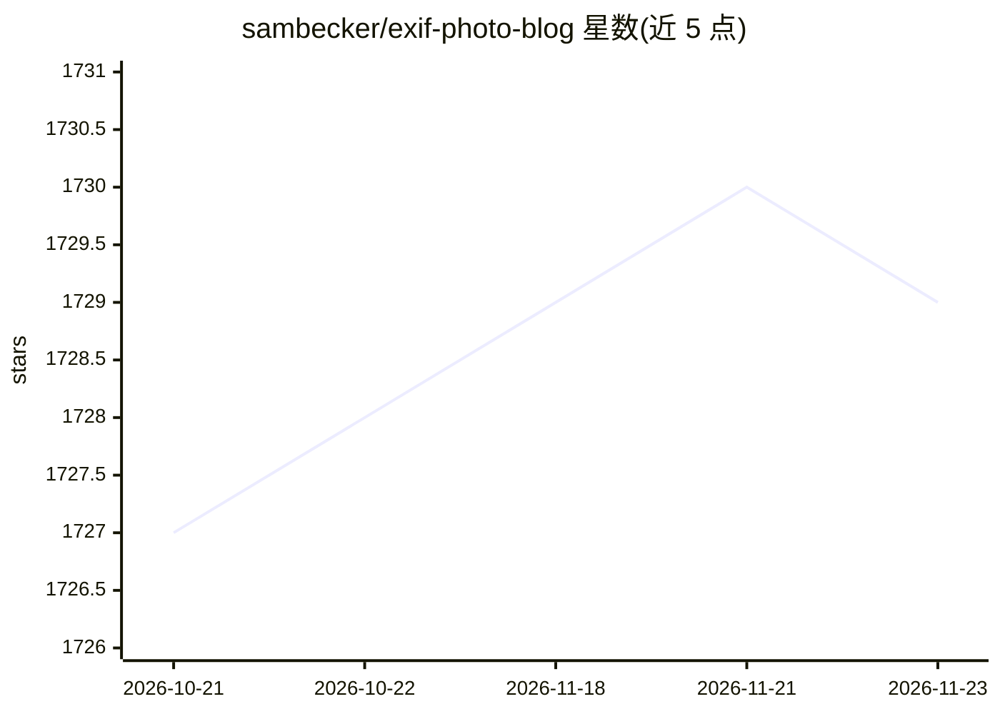

# sambecker/exif-photo-blog

⭐ 1,729 · TypeScript · 推送 2026-11-22 · [GitHub](https://github.com/sambecker/exif-photo-blog) · [官网](https://photos.sambecker.com) · 个人维护

**摄影博客模板：为每张照片记录并展示 EXIF 参数**

基于 Next.js 的照片博客模板，部署到 Vercel 使用 Vercel Postgres 与 Vercel Blob 存储。提供内置鉴权、带 EXIF 提取的照片上传、标签组织、无限滚动、明暗模式、OG 图自动生成、CMD-K 搜索与 RSS/JSON 订阅，并支持富士及 OM SYSTEM/Olympus 胶片模拟配方展示。可选启用 AI 功能：通过 Vercel AI Gateway 或 OpenAI（含 OpenAI 兼容端点）生成照片的文字描述与颜色分析；位置元数据依赖 Google Places/Geocoding API。更新通过 fork 仓库获取。

## 筛选速览

| 维度 | 判定 | 备注 |
|---|---|---|
| AI 角色 | `ai-enhanced` | 去掉 AI 部分产品仍成立 |
| 许可风险 | `none` | — |
| 部署形态 | `library` | 以包/库形式分发 |
| 模型依赖 | — | README 未给出锁定关系 |
| 硬件要求 | — | 无带数字的原话,不猜 |
| 安装摩擦 | `low` | 无编译、无系统依赖或容器化 |
| 成熟度 | — | 结构信号不足 |

## 能力要点

- 照片上传时自动提取 EXIF（光圈、快门、ISO 等）
- 可选 AI 生成标题/描述/标签/语义字段，支持 OpenAI 兼容端点
- 支持 S3、Cloudflare R2、MinIO 等存储后端的程序化上传脚本
- 按相机、镜头、配方、焦距等多维分类浏览与排序

## 适用场景

- 搭建展示拍摄参数的个人摄影博客
- 管理带标签与分类的摄影作品集
- 上传照片时自动生成标题与描述文案

## 场景标签

`AI 写作` · 领域:内容生成

## 证据(README 行号)

> L26: - Photo upload with EXIF extraction
> L32: - AI-generated text descriptions
> L109: To enable AI-powered color analysis and text descriptions of photos, configure a provider. Vercel AI Gateway is th

## 星数曲线

2026-10-21 1,727 → 2026-11-23 1,729（+2）

---
*卡片 v1 · prompt 1.4 · 生成 2026-11-23 · 置信度 high · 依据 README sha `d221fa65721f` · [字段定义](../../DATASET.md)*
