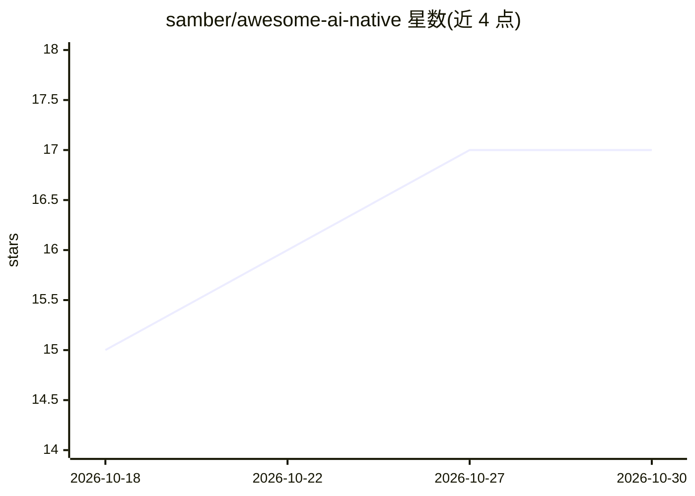

# samber/awesome-ai-native

⭐ 17 · Astro · CC0-1.0 · 推送 2026-10-29 · [GitHub](https://github.com/samber/awesome-ai-native) · [官网](https://samber.github.io/awesome-ai-native/) · 个人维护

**AI 原生产品精选清单：收录以 LLM 为本体的应用与工具**

由 samber 维护的 awesome 类策展清单，收录以 LLM 为产品本体（而非附加功能）的应用与资源，并声明收录门槛：仅指向产品本身，产品关闭或转向后移除条目。条目按消费级助手、通用 agent、自托管个人 agent、计算机操作模型、vibe-coding 工具、知识工作、行业应用（客服/销售/法律/医疗等）分类组织，每条附一句事实性描述。给需要了解 AI 原生产品版图的开发者与选型者使用。

## 筛选速览

| 维度 | 判定 | 备注 |
|---|---|---|
| AI 角色 | `ai-knowledge` | 知识聚合/清单类 |
| 许可风险 | `viral` | CC0-1.0 |
| 部署形态 | `None` |  |
| 模型依赖 | — | README 未给出锁定关系 |
| 硬件要求 | — | 无带数字的原话,不猜 |
| 安装摩擦 | `medium` | 含编译或系统依赖之一 |
| 成熟度 | — | 结构信号不足 |

## 能力要点

- 按 10+ 个类别组织 AI 原生产品条目，每条附事实性描述
- 明确收录标准：LLM 为产品本体，附加式 AI 功能不收录
- 产品关闭或转向后移除条目

## 适用场景

- 查找并比较各类 AI 原生产品（聊天、agent、编码、知识工作）
- 了解自托管个人 AI agent 的开源选项
- 按行业（法律、销售、客服）浏览垂直 AI 产品

## 场景标签

`精选清单` · 领域:学习与行业

## 证据(README 行号)

> L3: > A curated list of AI-native products and resources, where an LLM is the product, not a feature.
> L5: The bar is deliberately high. "AI-powered" sidebars, summarize buttons, and semantic search bolted onto legacy produ

## 星数曲线

2026-10-18 15 → 2026-10-30 17（+2）

---
*卡片 v1 · prompt 1.4 · 生成 2026-10-29 · 置信度 high · 依据 README sha `bb889b453fc8` · [字段定义](../../DATASET.md)*
