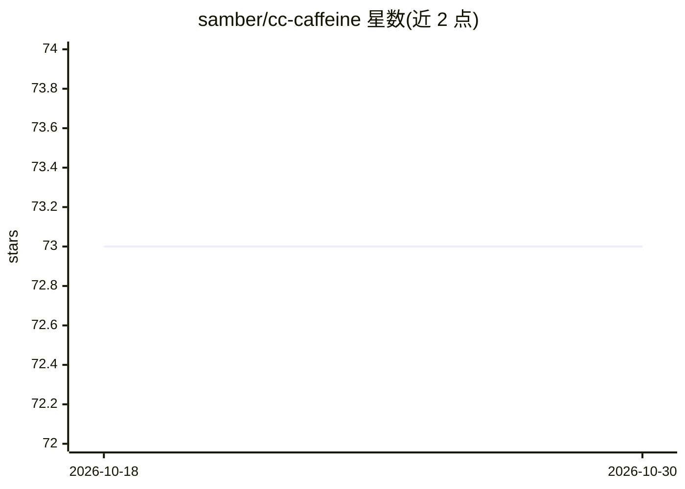

# samber/cc-caffeine

⭐ 73 · JavaScript · MIT · 推送 2026-10-25 · [GitHub](https://github.com/samber/cc-caffeine) · 个人维护

**在 Claude Code 工作时阻止电脑休眠的插件**

Claude Code 插件，监测会话状态并利用 Electron 电源管理在 Claude Code 工作期间阻止 macOS/Linux/Windows 电脑休眠，系统托盘显示咖啡图标指示状态。架构为客户端-服务器：轻量客户端（caffeinate/uncaffeinate）写入 JSON，后台无头 Electron 服务器管理电源；会话 15 分钟无工具调用或用户输入后自动过期。可通过插件市场安装，或 npx 独立运行。仓库已标注 DEPRECATED AND UNMAINTAINED，建议改用 Amphetamine。

## 筛选速览

| 维度 | 判定 | 备注 |
|---|---|---|
| AI 角色 | `ai-enhanced` | 去掉 AI 部分产品仍成立 |
| 许可风险 | `permissive` | MIT |
| 部署形态 | `library` | 以包/库形式分发 |
| 模型依赖 | — | README 未给出锁定关系 |
| 硬件要求 | — | 无带数字的原话,不猜 |
| 安装摩擦 | `low` | 无编译、无系统依赖或容器化 |
| 成熟度 | — | 结构信号不足 |

## 能力要点

- 基于 Claude Code hooks 的会话级睡眠阻止，支持多会话
- 客户端-服务器架构：轻量客户端写 JSON，无头 Electron 服务器管电源
- 15 分钟无活动自动过期清理
- 跨平台（macOS/Linux/Windows），托盘图标显示状态

## 适用场景

- 通勤路上让背包里的笔记本保持 Claude Code 连接
- 离开座位时防止电脑休眠中断编码会话
- 在咖啡店等场所长时间保持 Claude Code 会话活跃

## 场景标签

 · 领域:开发者工具/桌面效率

## 证据(README 行号)

> L43: **Automatic Intelligence**: cc-caffeine knows when Claude Code is working and prevents your computer from sleeping.
> L70: - **⚡ Native Sleep Prevention**: Electron's power management - cross-platform sleep prevention

## 星数曲线

2026-10-18 73 → 2026-10-30 73（+0）

---
*卡片 v1 · prompt 1.4 · 生成 2026-10-24 · 置信度 high · 依据 README sha `0bb328e55aa9` · [字段定义](../../DATASET.md)*
