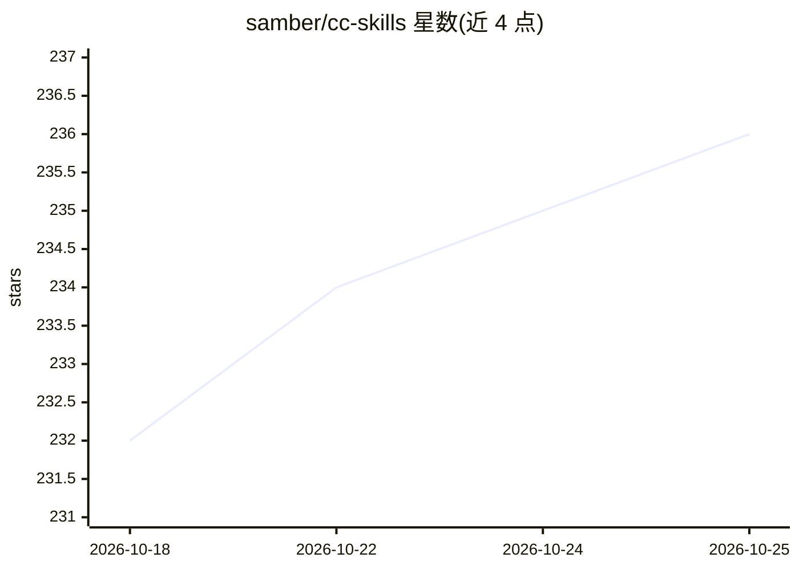

# samber/cc-skills

⭐ 236 · CSS · MIT · 推送 2026-10-01 · [GitHub](https://github.com/samber/cc-skills) · [官网](https://skills.sh/samber/cc-skills) · 个人维护

**面向 AI agent 的可复用技能集合：按需加载的领域指令集**

由 @samber 维护的 Agent Skills 技能集合，覆盖工程、营销内容、DevRel、生产力与元技能五大类共 20+ 个技能。每个技能以 SKILL.md 为入口，采用渐进式披露设计：description 常驻上下文用于触发，主体与 references/ 深度文件按需加载，避免占用上下文预算。技能被组织为原子且交叉引用的单元，建议整组安装。提供 skills CLI（npx skills add）、Claude Code 插件、Gemini CLI 扩展、Cursor/Copilot/OpenCode/Codex/Antigravity 等多种安装通道。附各技能 token 权重表与评测结果，声明由 Claude 引导生成但经人工编辑测试。

## 筛选速览

| 维度 | 判定 | 备注 |
|---|---|---|
| AI 角色 | `ai-knowledge` | 知识聚合/清单类 |
| 许可风险 | `permissive` | MIT |
| 部署形态 | `library` | 以包/库形式分发 |
| 模型依赖 | — | README 未给出锁定关系 |
| 硬件要求 | — | 无带数字的原话,不猜 |
| 安装摩擦 | `low` | 无编译、无系统依赖或容器化 |
| 成熟度 | — | 结构信号不足 |

## 能力要点

- 20+ 个跨工程/营销/DevRel/生产力/元技能的 SKILL.md 技能，按需惰性加载
- 提供 npx skills CLI 及 Claude Code、Gemini CLI、Cursor、Copilot、Codex、Antigravity 等安装通道
- 每个技能标注 description/SKILL.md/目录的 token 权重，并附 with/without 评测对比
- 支持公司自有技能显式覆盖声明（supersedes 机制）

## 适用场景

- 为 Claude Code / Cursor / Copilot 等编码助手补充 git 规范、PromQL、Chrome 扩展等工程技能
- 让 AI 助手按品牌调性产出文案、新闻稿与 LinkedIn/Substack 内容
- 为团队建立可按需加载、不膨胀上下文的领域知识技能库

## 场景标签

`提示工程` · 领域:Agent 开发

## 证据(README 行号)

> L3: AI agent skills are reusable instruction sets that extend your assistant with domain-specific expertise, loaded on d
> L107: ## 🧩 Skills

## 星数曲线

2026-10-18 232 → 2026-10-25 236（+4）

---
*卡片 v1 · prompt 1.4 · 生成 2026-10-22 · 置信度 high · 依据 README sha `05d4d530852a` · [字段定义](../../DATASET.md)*
