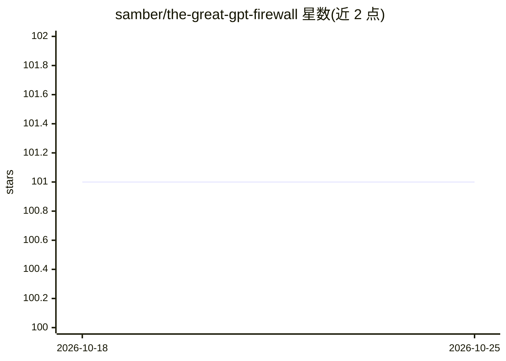

# samber/the-great-gpt-firewall

⭐ 101 · Python · MIT · 推送 2026-10-01 · [GitHub](https://github.com/samber/the-great-gpt-firewall) · 个人维护

**记录各网站通过 robots.txt 屏蔽 AI 爬虫的扫描清单**

对新闻媒体、流媒体、社交平台、学术出版、开发者站点等约 200 个网站进行 robots.txt 扫描，按 11 个类别列出各站点对 AI Agent/AI 爬虫的封锁状态（通过/封锁/未知）及国别，每月更新并附各类别统计比例。README 说明 robots.txt 指令机制与常见爬虫 User-agent（如 GPTBot），并提供 Python 抓取脚本用于重新扫描生成表格，供关注 AI 爬虫与内容封锁话题的人查阅。

## 筛选速览

| 维度 | 判定 | 备注 |
|---|---|---|
| AI 角色 | `ai-knowledge` | 知识聚合/清单类 |
| 许可风险 | `permissive` | MIT |
| 部署形态 | `library` | 以包/库形式分发 |
| 模型依赖 | — | README 未给出锁定关系 |
| 硬件要求 | — | 无带数字的原话,不猜 |
| 安装摩擦 | `low` | 无编译、无系统依赖或容器化 |
| 成熟度 | — | 结构信号不足 |

## 能力要点

- 约 200 个网站、11 个类别的 robots.txt 封锁状态扫描结果
- 每类别附通过/封锁/未知比例统计，每月更新
- 提供 scrape.py 抓取脚本可重新扫描
- 声明清单仅作信息用途，认可网站限制爬虫的权利

## 适用场景

- 查看我关注的新闻或流媒体网站是否屏蔽 AI 爬虫
- 了解各内容行业对 AI Agent 的封锁比例分布
- 基于扫描脚本自行更新或扩展网站数据

## 场景标签

`精选清单` · 领域:学习与行业

## 证据(README 行号)

> L1: # The Great GPT Firewall 📛
> L3: This collection is a curated list of websites that employ the `robots.txt` file to restrict access to AI Agents, AI 

## 星数曲线

2026-10-18 101 → 2026-10-25 101（+0）

---
*卡片 v1 · prompt 1.4 · 生成 2026-10-23 · 置信度 mid · 依据 README sha `dfc566623bac` · [字段定义](../../DATASET.md)*
