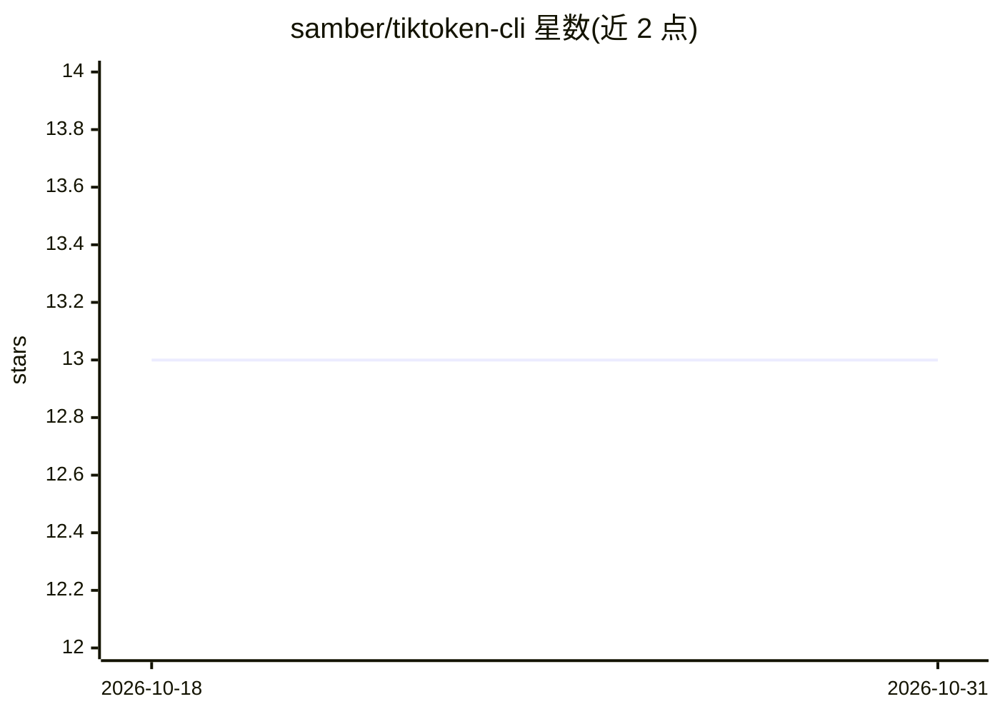

# samber/tiktoken-cli

⭐ 13 · JavaScript · MIT · 推送 2026-06-03 · [GitHub](https://github.com/samber/tiktoken-cli) · 个人维护

**统计文件与目录 token 数的命令行工具，供 LLM 开发者估算用量**

基于 OpenAI tiktoken 分词器的 Node CLI：对单个文件、stdin、多个文件或目录统计 token 数，默认模型 gpt-4o，可通过 --model 指定 tiktoken 支持的模型（gpt-4o、gpt-4、gpt-3.5-turbo、o1 系列等）。支持 glob 排除模式（*、**，锚定路径或任意位置匹配）。无需安装即可用 npx 运行，也可 npm 全局安装后直接调用。面向需要估算 API 成本、检查上下文窗口上限或审计 prompt 体积的用户。

## 筛选速览

| 维度 | 判定 | 备注 |
|---|---|---|
| AI 角色 | `ai-ecosystem` | LLM/agent 周边工具 |
| 许可风险 | `permissive` | MIT |
| 部署形态 | `library` | 以包/库形式分发 |
| 模型依赖 | — | README 未给出锁定关系 |
| 硬件要求 | — | 无带数字的原话,不猜 |
| 安装摩擦 | `low` | 无编译、无系统依赖或容器化 |
| 成熟度 | — | 结构信号不足 |

## 能力要点

- 支持单文件、stdin、多文件与目录的 token 统计
- 通过 --model 指定 tiktoken 支持的任意模型（默认 gpt-4o）
- glob 排除模式（*、**，支持锚定路径）
- npx 免安装直接运行

## 适用场景

- 调用 LLM API 前估算 prompt 的 token 数与成本
- 检查文件体积是否超出目标模型的上下文窗口
- 批量审计代码库或目录的 token 占用

## 场景标签

 · 领域:LLM 开发工具

## 证据(README 行号)

> L8: **Count tokens in files and directories from your terminal.** Powered by OpenAI's tiktoken tokenizer.
> L10: Perfect for estimating API costs, checking context window limits, or auditing prompt sizes before sending them to O

## 星数曲线

2026-10-18 13 → 2026-10-31 13（+0）

---
*卡片 v1 · prompt 1.4 · 生成 2026-10-31 · 置信度 high · 依据 README sha `049aec9e8531` · [字段定义](../../DATASET.md)*
