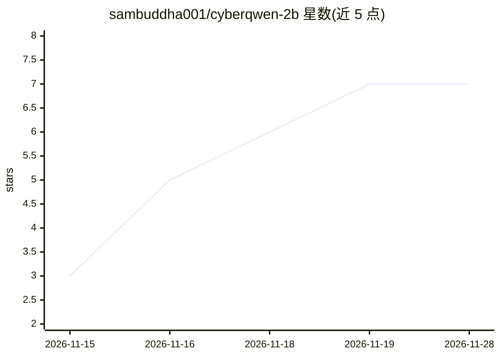

# sambuddha001/cyberqwen-2b

⭐ 7 · Jupyter Notebook · Apache-2.0 · 推送 2026-11-26 · [GitHub](https://github.com/sambuddha001/cyberqwen-2b) · 个人维护

**离线运行的 2B 网络安全小模型：漏洞分诊、CTF 与载荷分析**

基于 Qwen 3.5 2B 基座加 LoRA GGUF 适配器（84 MB）的网络安全专用小语言模型，宣称在 10 个安全领域数据集上微调。通过 Ollama 或 llama.cpp 在 CPU 上离线运行，随仓库提供 setup.sh 一键安装脚本、cyber-qwen CLI 启动器和零依赖 Python 工具 cyber_triage.py（日志分诊与 IOC 提取）。内置 Modelfile 配置，需自备无专用 GPU 的普通硬件即可运行。

## 筛选速览

| 维度 | 判定 | 备注 |
|---|---|---|
| AI 角色 | `ai-native` | 本体是模型或模型工具 |
| 许可风险 | `permissive` | Apache-2.0 |
| 部署形态 | `desktop` | 安装包/桌面程序 |
| 模型依赖 | local-ok | 支持本地模型 |
| 硬件要求 | — | 无带数字的原话,不猜 |
| 安装摩擦 | `low` | 无编译、无系统依赖或容器化 |
| 成熟度 | — | 结构信号不足 |

## 能力要点

- 以 LoRA GGUF 适配器形式分发，通过 ollama create 构建模型
- CPU 推理：README 记录 i5-8350U 上 12–15 tokens/sec、约 1.6–2.0 GB 内存
- 附带 cyber_triage.py 零依赖 CLI，支持日志管道分诊与 IOC 提取
- 覆盖 Web 安全、AD/企业攻防等 10 个安全知识域

## 适用场景

- 在隔离网络环境中对敏感日志做漏洞分诊与 IOC 提取
- CTF 解题与渗透测试实验中生成测试 payload 语法
- 无 GPU 笔记本上本地运行安全分析模型

## 场景标签

`网络安全` · 领域:学习与行业

## 证据(README 行号)

> L13: **CyberQwen-2B** is an ultra-lightweight, high-density cybersecurity Small Language Model (SLM) engineered to run *
> L101: Once downloaded, build with `ollama create cybersec-qwen -f Modelfile`.
> L107: This repository includes `cyber_triage.py`, a zero-dependency Python tool to integrate CyberQwen-2B into automated

## 星数曲线

2026-11-15 3 → 2026-11-28 7（+4）

---
*卡片 v1 · prompt 1.4 · 生成 2026-11-20 · 置信度 mid · 依据 README sha `9b339f922916` · [字段定义](../../DATASET.md)*
