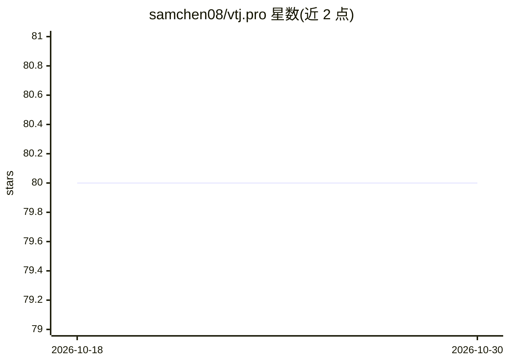

# samchen08/vtj.pro

⭐ 80 · TypeScript · MIT · 推送 2026-10-21 · [GitHub](https://github.com/samchen08/vtj.pro) · [官网](https://vtj.pro) · 组织维护 · 中文 README

**面向专业开发者的 AI 低代码引擎，产出标准 Vue3 代码**

基于 Vue3 + TypeScript + Vite 的开源低代码引擎，通过 DSL 与 Vue 源码双向转换，支持可视化设计器与手写代码之间切换，导出标准 Vue 项目以避免平台锁定。支持 Web/H5/UniApp 多端输出、私有化部署与离线运行。AI 部分参与页面生成、设计稿读取、逻辑编排与代码修复。内置低代码引擎可独立调用，物料库提供企业级组件与页面模板。提供在线平台与 npm 脚手架本地搭建两种使用方式，本地开发要求 Node v20+。

## 筛选速览

| 维度 | 判定 | 备注 |
|---|---|---|
| AI 角色 | `ai-enhanced` | 去掉 AI 部分产品仍成立 |
| 许可风险 | `permissive` | MIT |
| 部署形态 | `library` | 以包/库形式分发 |
| 模型依赖 | — | README 未给出锁定关系 |
| 硬件要求 | — | 无带数字的原话,不猜 |
| 安装摩擦 | `low` | 无编译、无系统依赖或容器化 |
| 成熟度 | — | 结构信号不足 |

## 能力要点

- DSL 与 Vue3 源码双向转换，导出标准 Vue 项目
- 自然语言/设计稿/网页截图智能生成 Vue 组件
- 支持 Web/H5/UniApp 多端输出与私有化部署、离线运行
- 内置可独立调用的低代码引擎与可定制物料库

## 适用场景

- 用可视化设计器搭建 Vue3 企业应用并导出标准代码
- 在现有工程中以零侵入方式引入低代码设计
- 跨端开发 Web、H5 与 UniApp 应用
- 基于引擎构建自有低代码平台

## 场景标签

`代码生成` · 领域:编码与开发

## 证据(README 行号)

> L10: VTJ.PRO 是一个开源的 AI 低代码引擎，专注解决 “低代码生成代码不可控、难维护” 的痛点。
> L59: - 🤖 **AI智能提效**: 支持通过自然语言/设计稿/网页截图**智能生成Vue组件**，快速实现需求可视化。

## 星数曲线

2026-10-18 80 → 2026-10-30 80（+0）

---
*卡片 v1 · prompt 1.4 · 生成 2026-10-24 · 置信度 high · 依据 README sha `09bb9c718403` · [字段定义](../../DATASET.md)*
