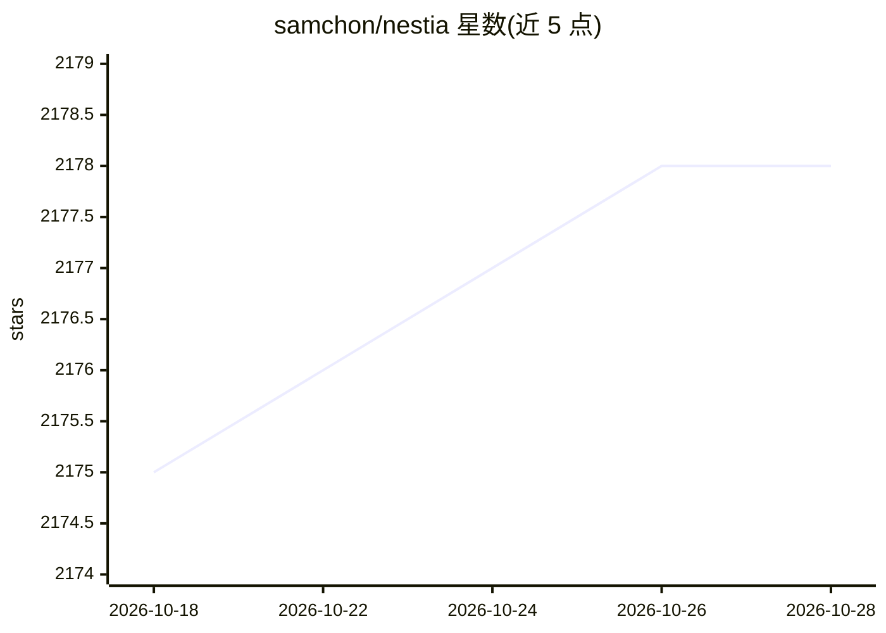

# samchon/nestia

⭐ 2,178 · TypeScript · MIT · 推送 2026-10-23 · [GitHub](https://github.com/samchon/nestia) · [官网](https://nestia.io/) · 个人维护

**面向 NestJS 开发者的助手库集：装饰器、SDK 生成与 AI Agent 工具链**

Nestia 是一组围绕 NestJS 的辅助库集合：@nestia/core 提供类型化装饰器与 WebSocket 路由；@nestia/sdk 从控制器代码生成客户端 SDK 库、Swagger 文档、Mockup 模拟器与 E2E 测试函数；另有 e2e 测试程序、基准测试程序与在线 Swagger 编辑器。AI 相关部分包括专注于 LLM 函数调用的 Agentic AI 库 @agentica，以及生成 NestJS 应用的 Vibe coding agent @autobe。面向使用 NestJS 的后端/全栈开发者，以 npm 包与 CLI 形式提供。README 中的性能倍数数据为作者自述。

## 筛选速览

| 维度 | 判定 | 备注 |
|---|---|---|
| AI 角色 | `ai-ecosystem` | LLM/agent 周边工具 |
| 许可风险 | `permissive` | MIT |
| 部署形态 | `None` |  |
| 模型依赖 | — | README 未给出锁定关系 |
| 硬件要求 | — | 无带数字的原话,不猜 |
| 安装摩擦 | `low` | 无编译、无系统依赖或容器化 |
| 成熟度 | — | 结构信号不足 |

## 能力要点

- @nestia/core：基于纯 TypeScript 类型的类型化装饰器与 WebSocket 路由
- @nestia/sdk：生成客户端 SDK、Swagger、Mockup 模拟器与 E2E 测试函数
- @agentica：专注 LLM 函数调用的 Agentic AI 库
- @autobe：生成 NestJS 应用的 Vibe coding agent

## 适用场景

- 用纯 TypeScript 类型注解替代手工校验与序列化代码
- 从 NestJS 服务端代码自动生成客户端 SDK 与 API 文档
- 基于函数调用能力构建 NestJS 相关的 AI Agent

## 场景标签

`代码生成` `编码 Agent` `Agent 框架` · 领域:Agent 开发

## 证据(README 行号)

> L12: Nestia is a set of helper libraries for NestJS, supporting below features:
> L25:  - `@agentica`: Agentic AI library specialized in LLM function calling
> L26:  - `@autobe`: Vibe coding agent generating NestJS application

## 星数曲线

2026-10-18 2,175 → 2026-10-28 2,178（+3）

---
*卡片 v1 · prompt 1.4 · 生成 2026-10-21 · 置信度 high · 依据 README sha `a2566da1e786` · [字段定义](../../DATASET.md)*
