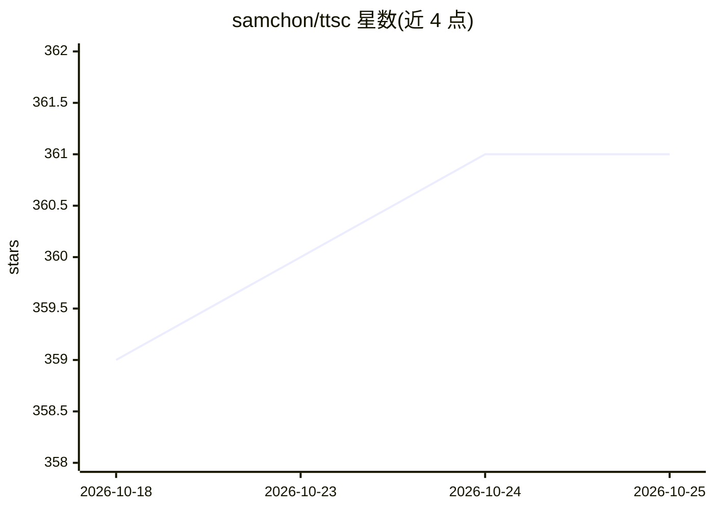

# samchon/ttsc

⭐ 361 · TypeScript · MIT · 推送 2026-10-25 · [GitHub](https://github.com/samchon/ttsc) · [官网](https://ttsc.dev/) · 个人维护

**TypeScript 工具链：tsc 替代品，含类型检查执行、lint、证据图与 MCP 代码图**

面向 TypeScript 开发者的 typescript-go 工具链，作为 tsc 的 drop-in 替代：读取同样的 tsconfig.json、接受同样的 flag 并输出同样的 JS，同时在类型检查 pass 中运行编译器插件。提供 ttsx（全项目类型检查后执行 TS）、@ttsc/lint（720+ 规则内嵌于类型检查流）、@ttsc/evidence（把需求文档条目变成编译期义务，未确认则构建失败）、@ttsc/graph（向编码 agent 暴露单个 MCP 工具的编译器知识图）。要求 typescript 7.0 或更高版本。

## 筛选速览

| 维度 | 判定 | 备注 |
|---|---|---|
| AI 角色 | `ai-ecosystem` | LLM/agent 周边工具 |
| 许可风险 | `permissive` | MIT |
| 部署形态 | `library` | 以包/库形式分发 |
| 模型依赖 | — | README 未给出锁定关系 |
| 硬件要求 | — | 无带数字的原话,不猜 |
| 安装摩擦 | `low` | 无编译、无系统依赖或容器化 |
| 成熟度 | — | 结构信号不足 |

## 能力要点

- tsc drop-in 替代，类型检查 pass 中运行编译器插件
- ttsx 执行前对整个项目做类型检查，类型错误阻止运行
- @evidence 标签把需求变成编译错误，未确认的义务使构建失败
- @ttsc/graph 通过 MCP server 向编码 agent 提供类型检查器解析的代码图

## 适用场景

- 在构建与执行 TypeScript 时同时运行 lint 与类型驱动插件
- 让需求文档条目在编译期被强制确认，未覆盖则构建失败
- 让编码 agent 通过 MCP 查询编译器知识图而非读源文件

## 场景标签

 · 领域:软件开发工具链/编译器

## 证据(README 行号)

> L7: A `typescript-go` toolchain for compiler-powered plugins and type-safe execution.
> L18: `ttsc` is a drop-in replacement for `tsc`. It reads the same `tsconfig.json`, takes the same flags, and emits the s
> L144: - `@ttsc/graph`: MCP server exposing a checker-resolved code graph to coding agents.

## 星数曲线

2026-10-18 359 → 2026-10-25 361（+2）

---
*卡片 v1 · prompt 1.4 · 生成 2026-10-21 · 置信度 high · 依据 README sha `0a633340939e` · [字段定义](../../DATASET.md)*
