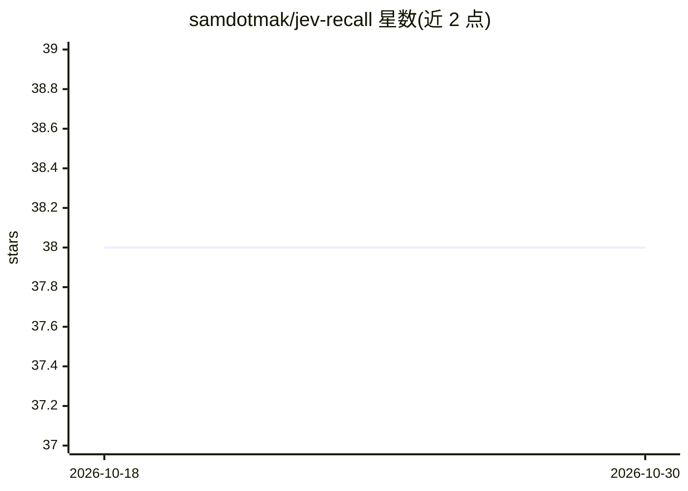

# samdotmak/jev-recall

⭐ 38 · TypeScript · MIT · 推送 2026-09-20 · [GitHub](https://github.com/samdotmak/jev-recall) · 个人维护

**AI 助手记忆检索过滤库：用 Jev 分类器按相关性筛选记忆**

面向构建 AI 助手的开发者，解决“写记忆容易、检索难”的问题：给定用户查询与一批记忆，通过 TypeSafe 的 Jev 模型对每条记忆做一次校准的是/否判断，返回相关记忆。机制上把全部记忆放入单个请求的共享 state，每条记忆对应一个小问题，Jev 返回校准概率，按阈值保留而非 top-k；大记忆库自动分片并发。提供三种模式（pointer/inline/shortlist）与异步版本 afilter，以 Python 库形式提供，另含 238 条虚构记忆的基准测试与 Next.js 演示站。需 TYPESAFE_API_KEY 才能运行库本身。

## 筛选速览

| 维度 | 判定 | 备注 |
|---|---|---|
| AI 角色 | `ai-ecosystem` | LLM/agent 周边工具 |
| 许可风险 | `permissive` | MIT |
| 部署形态 | `library` | 以包/库形式分发 |
| 模型依赖 | — | README 未给出锁定关系 |
| 硬件要求 | — | 无带数字的原话,不猜 |
| 安装摩擦 | `low` | 无编译、无系统依赖或容器化 |
| 成熟度 | — | 结构信号不足 |

## 能力要点

- 单请求共享 state + 指针式是/否判断，返回校准概率
- 按阈值保留结果，无相关记忆时不返回任何内容
- 大记忆库自动分片并发，提供异步 afilter 与 inline/shortlist 两种备选模式
- 附 238 条虚构记忆、18 个查询的基准测试与 Next.js 演示站

## 适用场景

- 我的 AI 助手有大量记忆，希望每轮按相关性过滤而非依赖向量相似度
- 避免语义检索漏掉与提问措辞不同但关键的记忆（如过敏、签证限制）
- 对比 BM25、嵌入、重排序与 LLM 作为记忆过滤器的成本和效果

## 场景标签

`Agent 记忆` · 领域:Agent 开发

## 证据(README 行号)

> L7: Given a user query and a pile of memories, jev recalls returns the most relevant memories, judged by
> L16: With LLMs, writing memories is easy. Knowing which ones to *retrieve* is the hard part.

## 星数曲线

2026-10-18 38 → 2026-10-30 38（+0）

---
*卡片 v1 · prompt 1.4 · 生成 2026-10-25 · 置信度 mid · 依据 README sha `39fe156c96e2` · [字段定义](../../DATASET.md)*
