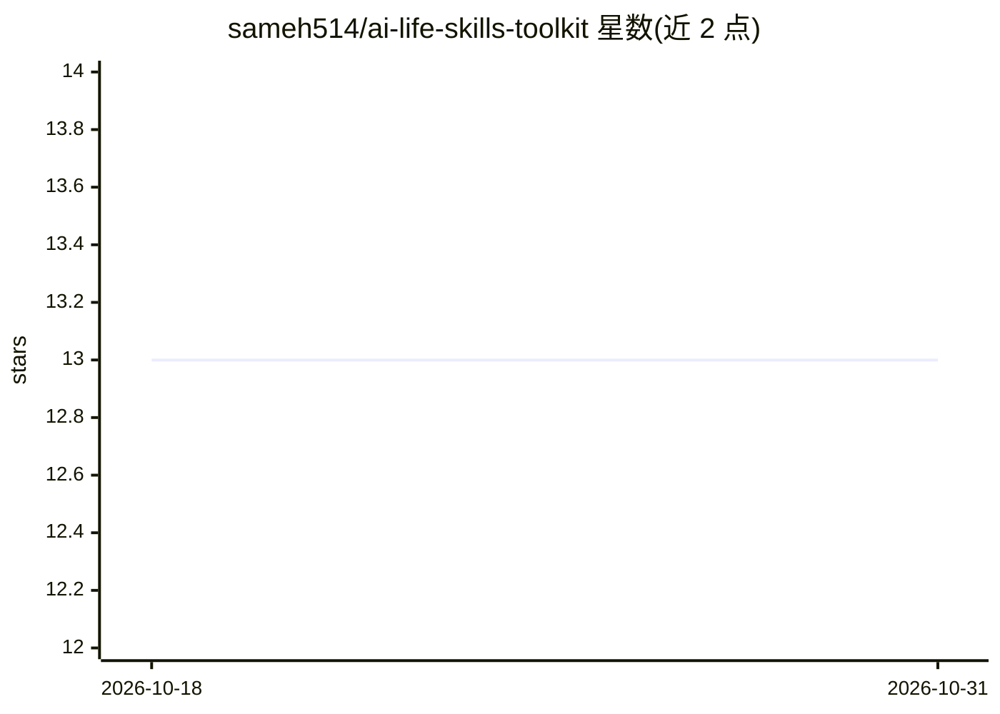

# sameh514/ai-life-skills-toolkit

⭐ 13 · Python · MIT · 推送 2026-08-30 · [GitHub](https://github.com/sameh514/ai-life-skills-toolkit) · 个人维护

**面向 Codex 的 8 个日常生活技能文件包（学习/客服/隐私）**

由个人维护的指令文件（skills）集合，包含 8 个教 AI 助手以固定流程处理日常任务的 SKILL 文件，覆盖课程练习生成、PPT 制作、手写笔记修正、课程音频复习、客服处理、自适应教学、浏览器选择与本地隐私资料最小化使用。源自作者用 AI 管理 ADHD 生活的流程设计；强调隐私优先：仓库不存个人信息，提供 AES-256-GCM 加密 vault（可选）与隐私扫描脚本。通过下载 ZIP 加 Python 脚本安装到 Codex，也可将 SKILL.md 附给其他接受指令文件的助手。

## 筛选速览

| 维度 | 判定 | 备注 |
|---|---|---|
| AI 角色 | `ai-knowledge` | 知识聚合/清单类 |
| 许可风险 | `permissive` | MIT |
| 部署形态 | `library` | 以包/库形式分发 |
| 模型依赖 | — | README 未给出锁定关系 |
| 硬件要求 | — | 无带数字的原话,不猜 |
| 安装摩擦 | `low` | 无编译、无系统依赖或容器化 |
| 成熟度 | — | 结构信号不足 |

## 能力要点

- 8 个可复用技能：学习、演示、客服、浏览器交接与隐私保护
- 可选 AES-256-GCM 加密 vault 存储本地个人资料
- privacy_scan.py 在发布前扫描常见隐私路径、密钥与令牌
- 无需 Git，Python 脚本一键安装到 Codex（Windows/macOS）

## 适用场景

- 让 AI 助手以固定流程帮我整理课程材料并生成练习
- 处理退款、换货等客服沟通流程
- 让 AI 使用我偏好的浏览器并最小化使用本地个人信息

## 场景标签

`提示工程` · 领域:Agent 开发

## 证据(README 行号)

> L5: Eight reusable “skills”: small instruction files that teach an AI assistant to
> L77: using `--replace` first makes a dated backup. These commands install into Codex.

## 星数曲线

2026-10-18 13 → 2026-10-31 13（+0）

---
*卡片 v1 · prompt 1.4 · 生成 2026-10-31 · 置信度 mid · 依据 README sha `d4042690dbf2` · [字段定义](../../DATASET.md)*
