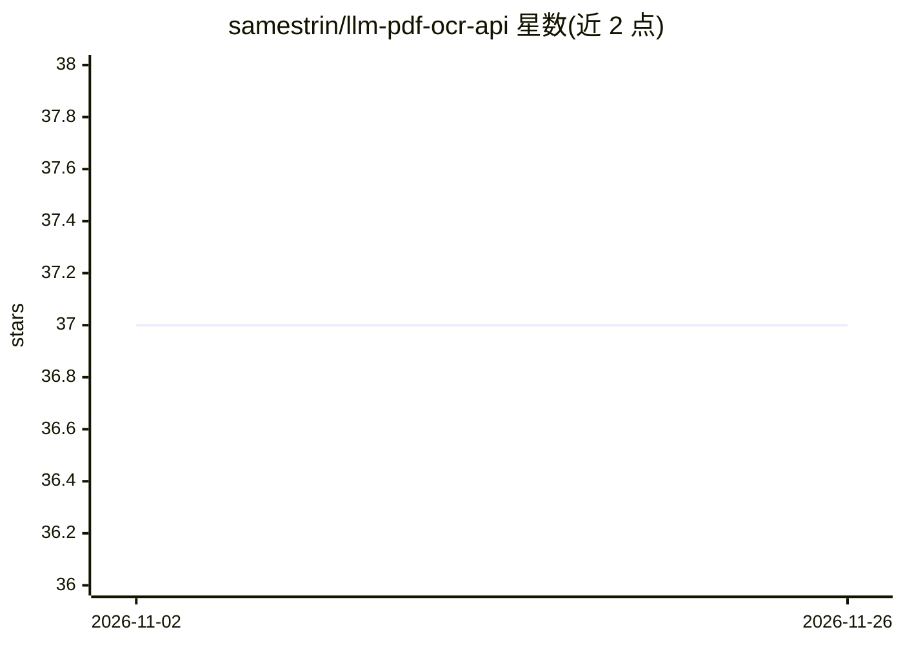

# samestrin/llm-pdf-ocr-api

⭐ — · [GitHub]() · 个人维护

**自托管的 PDF OCR REST 服务：逐页提取文本并标注读取方式**

基于 FastAPI 的自托管服务，逐页读取 PDF（扫描件或原生），返回 Markdown 或 JSON，并标明每页的读取方法：text_layer（PDF 自带文本层）、tesseract（带置信度的 OCR）或可选配置的视觉模型（本地或云端，OpenAI 兼容端点）。无法读取的页报为 failed 而非空白；长 PDF 可作为带逐页进度的作业运行；附带浏览器上传网页。以 Docker 镜像分发，也支持 uv 本地运行。限制：作业存于单进程内存、一次一个，重启即丢失。

## 筛选速览

| 维度 | 判定 | 备注 |
|---|---|---|
| AI 角色 | `ai-native` | 本体是模型或模型工具 |
| 许可风险 | `permissive` | — |
| 部署形态 | `self-host` | docker 或自建部署 |
| 模型依赖 | local-ok | 支持本地模型 |
| 硬件要求 | — | 无带数字的原话,不猜 |
| 安装摩擦 | `low` | 无编译、无系统依赖或容器化 |
| 成熟度 | — | 结构信号不足 |

## 能力要点

- 每页按成本选择读取方式（text_layer/tesseract/vision）并在结果中标注方法
- 长 PDF 以作业模式运行，含逐页进度与页图 PNG 输出
- 视觉后端通过 OpenAI 兼容端点配置，可选本地 Ollama 或云服务
- 公开演示模式下 text_layer 与 tesseract 免费可用，视觉读取需演示码或用户自备密钥

## 适用场景

- 批量提取扫描或原生 PDF 的文本并转为 Markdown
- 需要知道每页可信度（方法与置信度）的文档处理
- 长 PDF 通过作业接口异步处理并跟踪进度

## 场景标签

`OCR` `文档解析` · 领域:知识与检索

## 证据(README 行号)

> L31: - Running every page through OCR is slow and loses good text. Each page is read the cheapest way that works: `text_
> L88: |`POST /v1/extract`|Read a PDF page by page and return Markdown or JSON. Fields: `file`, `format`, `pages`, `method

## 星数曲线

2026-11-02 37 → 2026-11-26 37（+0）

---
*卡片 v1 · prompt 1.4 · 生成 2026-11-18 · 置信度 high · 依据 README sha `8d2790d1774d` · [字段定义](../../DATASET.md)*
