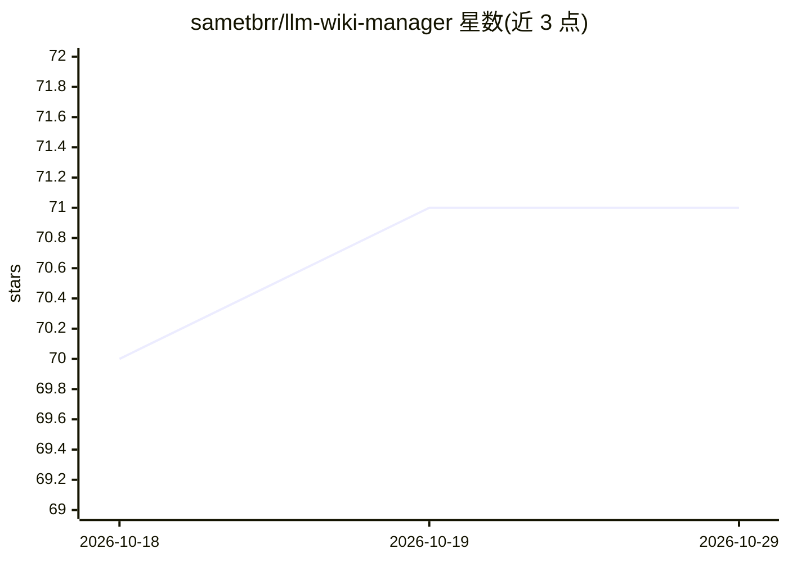

# sametbrr/llm-wiki-manager

⭐ 71 · Python · MIT · 推送 2026-09-25 · [GitHub](https://github.com/sametbrr/llm-wiki-manager) · 个人维护

**Claude Code 技能：让 LLM 持续编写与交叉维护个人知识库 wiki**

一个面向 Claude Code 及 agentskills.io 兼容 agent 的技能包，实现 Karpathy 的 LLM Wiki 模式：用户策展 raw/ 目录下的来源文件，LLM 负责读取、撰写摘要与实体/概念页、更新交叉引用、标记矛盾并维护 index.md 与 log.md。提供 8 种操作模式（含多 wiki 路由）、5 个幂等的纯标准库 Python 脚本、8 个页面模板与 11 份参考文档。安装方式为 git clone 到 skills 目录、GitHub CLI 或 .skill 文件解压，需 Python 3.9+。

## 筛选速览

| 维度 | 判定 | 备注 |
|---|---|---|
| AI 角色 | `ai-native` | 本体是模型或模型工具 |
| 许可风险 | `permissive` | MIT |
| 部署形态 | `library` | 以包/库形式分发 |
| 模型依赖 | — | README 未给出锁定关系 |
| 硬件要求 | — | 无带数字的原话,不猜 |
| 安装摩擦 | `low` | 无编译、无系统依赖或容器化 |
| 成熟度 | — | 结构信号不足 |

## 能力要点

- 8 种操作模式：Bootstrap/Ingest/Query/Update/Lint/Schema-evolve/Multi-wiki/Teach
- 5 个幂等 Python 脚本（纯标准库，无 pip 依赖）
- 三层结构：LLM 拥有 wiki/，用户拥有不可变的 raw/，schema 存于 CLAUDE.md
- 支持多 wiki 路由（项目 wiki 与全局 wiki，兼容 Obsidian 链接格式）

## 适用场景

- 把研究资料持续编译成可复用的个人知识库
- 多来源研究中让 LLM 标记矛盾并溯源到具体来源文件
- 在项目 wiki 与全局第二大脑之间路由与晋升页面

## 场景标签

`知识库管理` · 领域:知识与检索

## 证据(README 行号)

> L7: A Claude Code skill for building and maintaining a personal LLM-managed wiki — a persistent, compounding knowledge b
> L26: Instead of RAG — where the LLM rediscovers answers from raw documents on every query — this pattern has the LLM **c

## 星数曲线

2026-10-18 70 → 2026-10-29 71（+1）

---
*卡片 v1 · prompt 1.4 · 生成 2026-10-24 · 置信度 mid · 依据 README sha `4265efca04eb` · [字段定义](../../DATASET.md)*
