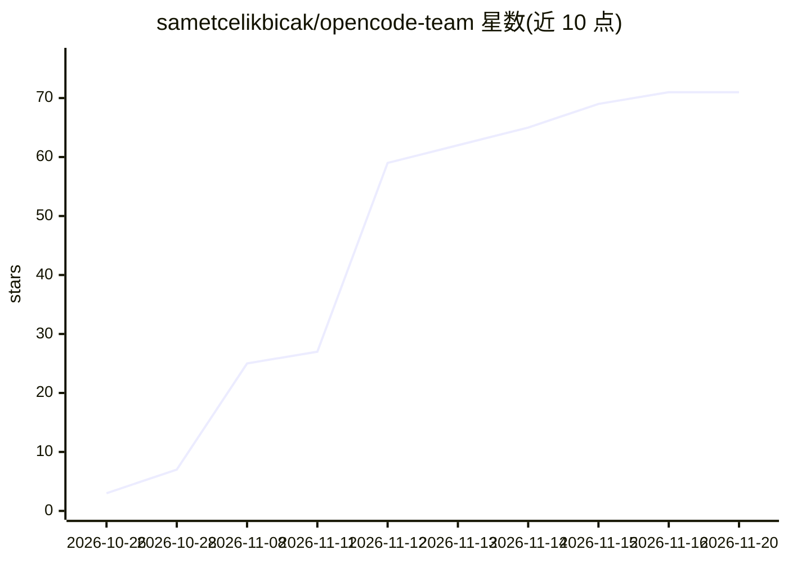

# sametcelikbicak/opencode-team

⭐ 71 · PowerShell · MIT · 推送 2026-11-13 · [GitHub](https://github.com/sametcelikbicak/opencode-team) · [官网](https://sametcelikbicak.github.io/opencode-team/) · 个人维护

**基于 opencode 的 14 角色 AI 软件团队流水线（构思到发布）**

构建在 OpenCode CLI 之上的多 agent 软件团队配置：14 个 agent 角色（分析师、产品、架构、前后端、QA、安全等）与编排器，12 个流水线阶段由 team.yaml 配置而非硬编码，每阶段产出 .team/ 目录下编号 markdown 工件，阶段间设人工审批门。安装方式为将 agents/commands/skills 符号链接到 OpenCode 配置目录，不绑定模型，使用 OpenCode 会话当前模型，任何 OpenCode 已配置的 provider 均可。附带项目本地记忆与运行检查点以保持跨会话连续性。声明与 OpenCode 官方无关联。

## 筛选速览

| 维度 | 判定 | 备注 |
|---|---|---|
| AI 角色 | `ai-ecosystem` | LLM/agent 周边工具 |
| 许可风险 | `permissive` | MIT |
| 部署形态 | `None` |  |
| 模型依赖 | — | README 未给出锁定关系 |
| 硬件要求 | — | 无带数字的原话,不猜 |
| 安装摩擦 | `low` | 无编译、无系统依赖或容器化 |
| 成熟度 | — | 结构信号不足 |

## 能力要点

- 14 个 agent 角色与编排器路由，12 个流水线阶段在 team.yaml 中可自由增删排序
- 14 个本地技能（含 team-memory、team-discipline），不克隆外部技能
- 每阶段写入 .team/ 编号工件，阶段门需用户审批
- 不锁定模型：agent 继承 OpenCode 会话活动模型，可按 agent 钉选

## 适用场景

- 在任意项目中用一个想法驱动从调研到发布的完整流水线
- 按阶段单独调用 agent（如只做 UX 或安全审查）
- 自定义裁剪团队流水线与角色

## 场景标签

`多智能体` `编码 Agent` · 领域:Agent 开发

## 证据(README 行号)

> L15: A team of AI agents that takes an idea from research to launch — built on opencode, with no framework and no extra 
> L25: - **14 agent roles** — analyst, pm, po, ux, brand, architect, fe, be, qa, devops, security, marketing, docs, and an
> L71: No agent pins a model: each one runs on the session's active model, so any provider configured in OpenCode works. T
> L113: - Any provider configured in OpenCode — OpenCode Zen or your own. Agents inherit the session's active model.

## 星数曲线

2026-10-26 3 → 2026-11-20 71（+68）

---
*卡片 v1 · prompt 1.4 · 生成 2026-11-18 · 置信度 high · 依据 README sha `6ab56b78965a` · [字段定义](../../DATASET.md)*
