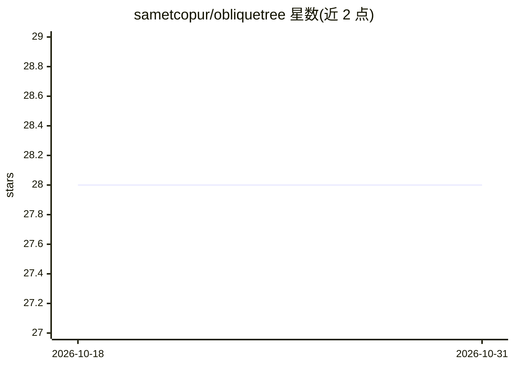

# sametcopur/obliquetree

⭐ 28 · Cython · MIT · 推送 2026-05-05 · [GitHub](https://github.com/sametcopur/obliquetree) · [官网](https://obliquetree.readthedocs.io/en/latest/) · 个人维护

**支持斜切分的决策树 Python 库，用于分类与回归**

决策树实现库，提供传统轴对齐切分与斜切分（特征线性组合）两种模式，覆盖分类与回归任务。斜切分通过自研 L-BFGS 优化确定线性权重，若无法降低不纯度则回退为轴对齐切分。原生支持类别型变量（仅需标签编码）与缺失值处理，可用 n_pair 参数限制参与斜切分的特征数；关闭斜切分与类别切分时结果与 scikit-learn 决策树一致。构建过程使用 OpenMP 并行搜索切分。面向使用 Python 的机器学习开发者。

## 筛选速览

| 维度 | 判定 | 备注 |
|---|---|---|
| AI 角色 | `ai-native` | 本体是模型或模型工具 |
| 许可风险 | `permissive` | MIT |
| 部署形态 | `library` | 以包/库形式分发 |
| 模型依赖 | — | README 未给出锁定关系 |
| 硬件要求 | — | 无带数字的原话,不猜 |
| 安装摩擦 | `low` | 无编译、无系统依赖或容器化 |
| 成熟度 | — | 结构信号不足 |

## 能力要点

- 斜切分使用特征线性组合，L-BFGS 优化求权重
- 原生支持类别型变量与缺失值（NaN 归入最优叶节点）
- 关闭斜切分与类别切分时结果与 scikit-learn 决策树一致
- OpenMP 并行切分搜索

## 适用场景

- 训练浅层且可解释的决策树模型
- 处理含线性关系数据的分类或回归
- 直接使用含类别列与缺失值的数据集而减少预处理

## 场景标签

 · 领域:机器学习/表格数据建模

## 证据(README 行号)

> L3: `obliquetree` is an advanced decision tree implementation designed to provide high-performance and interpretable mod
> L37: - **Oblique Splits**

## 星数曲线

2026-10-18 28 → 2026-10-31 28（+0）

---
*卡片 v1 · prompt 1.4 · 生成 2026-10-26 · 置信度 high · 依据 README sha `77f0d143b4aa` · [字段定义](../../DATASET.md)*
