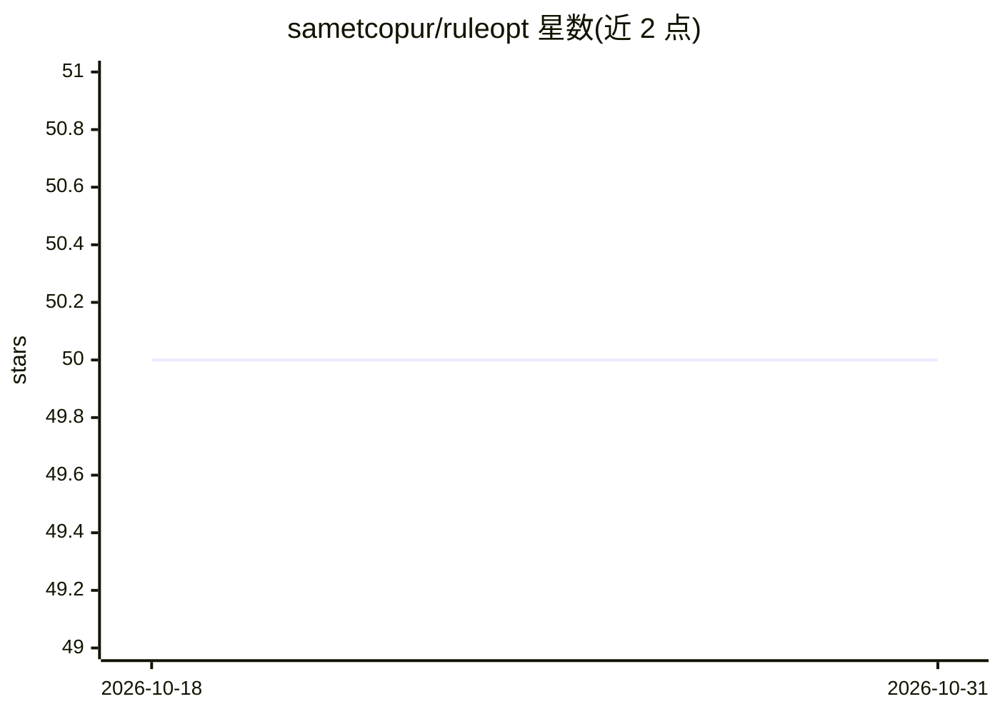

# sametcopur/ruleopt

⭐ 50 · Python · BSD-3-Clause · 推送 2026-03-26 · [GitHub](https://github.com/sametcopur/ruleopt) · [官网](https://ruleopt.readthedocs.io) · 个人维护

**基于线性规划的分类规则学习 Python 库**

Python 库 ruleopt，用线性规划做规则生成与规则提取：既可作为独立分类方法生成规则，也可从已训练的随机森林和 Boosting 集成模型中提取规则。规则被赋予成本以在精度与可解释性间取得平衡，面向需要可解释模型的数据科学场景。支持 HiGHS、Gurobi、CPLEX 求解器，兼容 scikit-learn、LightGBM、XGBoost 及现有机器学习流水线。pip 安装，BSD 3-Clause 许可；早期版本见作者期刊论文但 README 未给出链接。

## 筛选速览

| 维度 | 判定 | 备注 |
|---|---|---|
| AI 角色 | `ai-native` | 本体是模型或模型工具 |
| 许可风险 | `permissive` | BSD-3-Clause |
| 部署形态 | `library` | 以包/库形式分发 |
| 模型依赖 | — | README 未给出锁定关系 |
| 硬件要求 | — | 无带数字的原话,不猜 |
| 安装摩擦 | `low` | 无编译、无系统依赖或容器化 |
| 成熟度 | — | 结构信号不足 |

## 能力要点

- 线性规划驱动的规则生成与提取
- 可从随机森林和 Boosting 模型提取规则
- 支持 HiGHS / Gurobi / CPLEX 求解器
- 兼容 scikit-learn、LightGBM、XGBoost 流水线

## 适用场景

- 训练可解释的规则分类模型
- 从已有集成树模型中提取可读规则
- 在大规模数据上做兼顾精度与透明度的分类

## 场景标签

 · 领域:机器学习/可解释 AI

## 证据(README 行号)

> L4: RuleOpt is an optimization-based rule learning algorithm designed for classification problems. Focusing on scalabili
> L10: - **Efficient Rule Generation and Extraction**: Leverages linear programming for scalable rule generation (stand-al

## 星数曲线

2026-10-18 50 → 2026-10-31 50（+0）

---
*卡片 v1 · prompt 1.4 · 生成 2026-10-24 · 置信度 high · 依据 README sha `66665458dd80` · [字段定义](../../DATASET.md)*
