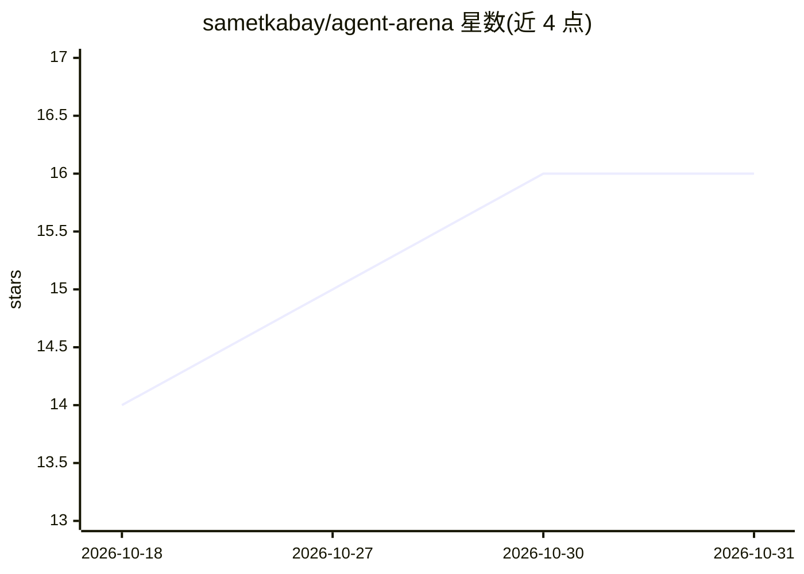

# sametkabay/agent-arena

⭐ 16 · TypeScript · MIT · 推送 2026-10-06 · [GitHub](https://github.com/sametkabay/agent-arena) · [官网](https://sametkabay.github.io/agent-arena/) · 个人维护

**浏览器端多智能体 3D 沙盒：在地图上放置 LLM 角色并对话**

纯浏览器运行的多智能体可视化沙盒：在办公室、森林或太空等 3D 地图上生成 LLM 驱动的角色，支持私聊、共享竞技场广播、@提及与可调频率的闲聊（气泡形式），点击/右键可选中或移动角色。内置全屏地图编辑器（.aamf.json 导入导出）与 YAML 配置体系（提示模板、角色、角色预设、地图）。接入 OpenAI、Gemini、Claude、Ollama 或任意 OpenAI 兼容网关，无自建后端，API key 存于 localStorage。需 Node.js 20+ 与 WebGL2 浏览器本地运行，自述为 v0.1.0 早期预览版。

## 筛选速览

| 维度 | 判定 | 备注 |
|---|---|---|
| AI 角色 | `ai-native` | 本体是模型或模型工具 |
| 许可风险 | `permissive` | MIT |
| 部署形态 | `library` | 以包/库形式分发 |
| 模型依赖 | local-ok | 支持本地模型 |
| 硬件要求 | — | 无带数字的原话,不猜 |
| 安装摩擦 | `low` | 无编译、无系统依赖或容器化 |
| 成熟度 | `idea` | |

## 能力要点

- 3D 地图上的 LLM 角色：私聊、竞技场广播、@提及、闲聊循环
- 内置全屏地图编辑器，.aamf.json 导入导出
- 支持 OpenAI / Gemini / Claude / Ollama / 自定义 OpenAI 兼容网关，无后端、key 存 localStorage
- YAML 配置提示模板、角色与地图，无需重新部署即可实验

## 适用场景

- 可视化原型验证 agent 人设与提示词
- 搭建小型多智能体场景并观察其互动
- 在同一界面并排对比不同 LLM 提供商的表现
- 探索带空间感的 agent UX 交互沙盒

## 场景标签

`多智能体` `提示工程` · 领域:Agent 开发

## 证据(README 行号)

> L3: **Agent Arena is an open-source, browser-native multi-agent playground.** You place LLM-powered characters on a 3D m
> L121: Use it to prototype agent personas, stage small multi-agent scenes, compare LLM providers side by side, or explore

## 星数曲线

2026-10-18 14 → 2026-10-31 16（+2）

---
*卡片 v1 · prompt 1.4 · 生成 2026-10-30 · 置信度 high · 依据 README sha `e37a922062f9` · [字段定义](../../DATASET.md)*
