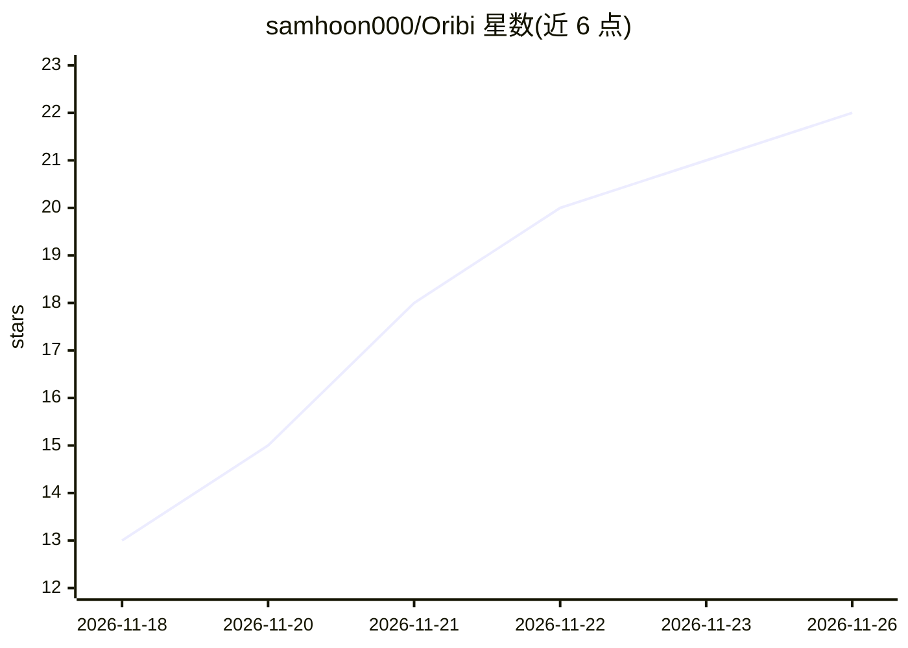

# samhoon000/Oribi

⭐ 22 · Python · MIT · 推送 2026-11-25 · [GitHub](https://github.com/samhoon000/Oribi) · 个人维护

**为 LLM 等下游工具生成 DataFrame 结构化画像的 Python 库**

读取 pandas DataFrame，输出包含行列规模、列级统计、语义角色推断、候选键、粒度估计、列间关系与数据质量警告的证据型快照，可导出为 Markdown 报告或 JSON。面向在写分析前检查数据、或向下游工具（如 LLM）提供紧凑数据描述的开发者。推断为启发式规则，README 明确声明是观察性证据而非业务含义保证；当前仅支持 pandas 内存数据，profiling 需多轮全列扫描，序列化输出标记 schema_version 且兼容性策略未稳定。

## 筛选速览

| 维度 | 判定 | 备注 |
|---|---|---|
| AI 角色 | `ai-ecosystem` | LLM/agent 周边工具 |
| 许可风险 | `permissive` | MIT |
| 部署形态 | `library` | 以包/库形式分发 |
| 模型依赖 | — | README 未给出锁定关系 |
| 硬件要求 | — | 无带数字的原话,不猜 |
| 安装摩擦 | `low` | 无编译、无系统依赖或容器化 |
| 成熟度 | — | 结构信号不足 |

## 能力要点

- 输出 COLUMN ROLES / RELATIONSHIPS / CARDINALITY 三段式紧凑上下文
- 关系置信度为确定性类型化权重组合（如键关系由唯一性/覆盖率/泛化/语义支持加权）
- inspect() 不修改 DataFrame 也不保留引用，支持 Markdown/JSON 序列化
- ProfileOptions 可限制 top 值与精确键/分位数分析的规模

## 适用场景

- 写分析前快速检查数据集结构与质量问题
- 给 LLM/下游工具提供不暴露原始数据的紧凑数据描述
- 分析事件/时间序列数据时估计粒度与时间间隔缺口

## 场景标签

`数据分析` · 领域:效率与自动化

## 证据(README 行号)

> L3: Oribi profiles a pandas DataFrame and returns a structured, evidence-backed snapshot of its shape, column statistics
> L84: Additional data sources, configurable semantic rules, cross-table foreign-key analysis, and richer profiling option

## 星数曲线

2026-11-18 13 → 2026-11-26 22（+9）

---
*卡片 v1 · prompt 1.4 · 生成 2026-11-18 · 置信度 mid · 依据 README sha `508ca5fc9213` · [字段定义](../../DATASET.md)*
