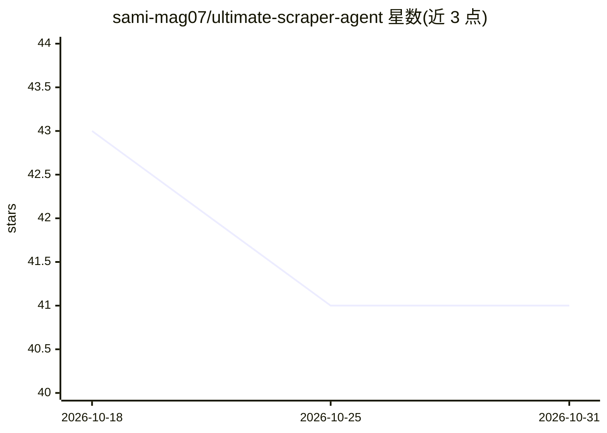

# sami-mag07/ultimate-scraper-agent

⭐ 41 · Python · MIT · 推送 2026-10-02 · [GitHub](https://github.com/sami-mag07/ultimate-scraper-agent) · 个人维护

**给 Claude Code 的研究技能与子代理：多引擎搜索加引用核验**

面向 Claude Code 的研究技能包：将多个搜索引擎（Tavily/Exa/Serper 及免密钥引擎）封装在一个接口后并按成本排序回退，可用 --fan 并行扇出并合并去重；提供最多 5 个一组的并行 researcher 子代理，通过 flock 保护的共享 seen 文件避免重复工作。核心是引用核验门：sources.py 只在引文逐字出现在抓取页面时才记录，verify 在所有引用有出处前以非零退出，--numbers 进一步要求数字声明出现在引文中。全部脚本仅用 Python 标准库，密钥经 .env 配置。技能文本与代理提示为德语，脚本与 README 为英语。

## 筛选速览

| 维度 | 判定 | 备注 |
|---|---|---|
| AI 角色 | `ai-ecosystem` | LLM/agent 周边工具 |
| 许可风险 | `permissive` | MIT |
| 部署形态 | `library` | 以包/库形式分发 |
| 模型依赖 | — | README 未给出锁定关系 |
| 硬件要求 | — | 无带数字的原话,不猜 |
| 安装摩擦 | `low` | 无编译、无系统依赖或容器化 |
| 成熟度 | — | 结构信号不足 |

## 能力要点

- 多搜索引擎单接口回退链与 --fan 并行扇出合并
- 逐字引文核验门：无出处的引用阻止报告完成，--numbers 补充数字声明核验
- 并行子代理波次（每组至多 5 个）经共享 seen 文件去重
- 零运行时依赖，脚本全部使用 Python stdlib

## 适用场景

- 让 Claude Code 做多引擎、可去重的网络研究
- 强制研究报告的每条引用附逐字引文并通过核验
- 并行派出子代理做宽域扫描而不重复抓取

## 场景标签

`网页抓取` `科研工具` · 领域:效率与自动化

## 证据(README 行号)

> L8: A research skill for Claude Code that treats web research like engineering: several search engines behind one interf
> L85: 1. Copy `skills/research-agent/` to `~/.claude/skills/research-agent/`.
> L86: 2. Copy `agents/researcher.md` to `~/.claude/agents/researcher.md`. It becomes visible in the next session.

## 星数曲线

2026-10-18 43 → 2026-10-31 41（-2）

---
*卡片 v1 · prompt 1.4 · 生成 2026-10-25 · 置信度 mid · 依据 README sha `6be3786663eb` · [字段定义](../../DATASET.md)*
