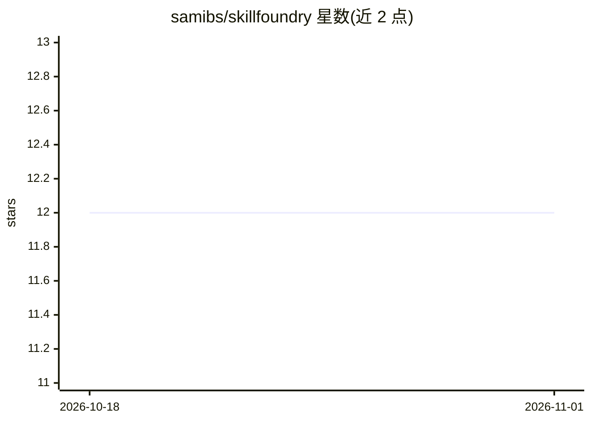

# samibs/skillfoundry

⭐ 12 · TypeScript · MIT · 推送 2026-10-02 · [GitHub](https://github.com/samibs/skillfoundry) · [官网](https://skillfoundry.work) · 个人维护

**AI 工程框架：PRD 先行流水线与不可跳过的质量门禁**

面向使用 AI 编程工具的开发者，提供 PRD 优先的开发流水线：需求文档先于代码生成，/forge 流水线串联实现、测试、审计。两种使用方式：独立 CLI（sf）自带 AI 连接，或作为技能层安装到 Claude Code、Cursor、Copilot、Codex、Gemini、Grok Build 等 IDE 工具。核心机制包括 agent 交接间的 Anvil 质量门禁（正确性契约、禁用模式扫描、类型检查、安全扫描）、Specter 威胁建模引擎、跨会话持久记忆与多 agent 团队。支持 6 个 AI 提供商及预算控制。限制：独立 CLI 需 Node.js v20+，自主模式仅 IDE 技能可用。

## 筛选速览

| 维度 | 判定 | 备注 |
|---|---|---|
| AI 角色 | `ai-ecosystem` | LLM/agent 周边工具 |
| 许可风险 | `permissive` | MIT |
| 部署形态 | `library` | 以包/库形式分发 |
| 模型依赖 | local-ok | 支持本地模型 |
| 硬件要求 | — | 无带数字的原话,不猜 |
| 安装摩擦 | `low` | 无编译、无系统依赖或容器化 |
| 成熟度 | — | 结构信号不足 |

## 能力要点

- PRD-first 流水线：需求文档先于任何代码编写并经验证
- agent 交接间的质量门禁：正确性契约、类型检查、测试、安全扫描
- 支持 6 个 AI 提供商（Anthropic/OpenAI/xAI/Google/Ollama/LM Studio）及预算上限
- 跨会话持久记忆与多 agent 团队路由

## 适用场景

- 在 Claude Code/Cursor 等 IDE 中以质量门禁约束 AI 生成的代码
- 无 IDE 环境下用独立 CLI 运行 PRD→实现→测试→审计流水线
- 对已有 diff 运行 /verify 质量门禁核验

## 场景标签

`多智能体` `代码生成` `Agent 框架` · 领域:Agent 开发

## 证据(README 行号)

> L13: SkillFoundry is an AI engineering framework that works two ways: as a **standalone CLI** (`sf`)
> L37: - **6 AI providers with budget controls.** Anthropic, OpenAI, xAI, Google, Ollama, LM Studio —

## 星数曲线

2026-10-18 12 → 2026-11-01 12（+0）

---
*卡片 v1 · prompt 1.4 · 生成 2026-11-01 · 置信度 high · 依据 README sha `b2b40e8a34ca` · [字段定义](../../DATASET.md)*
