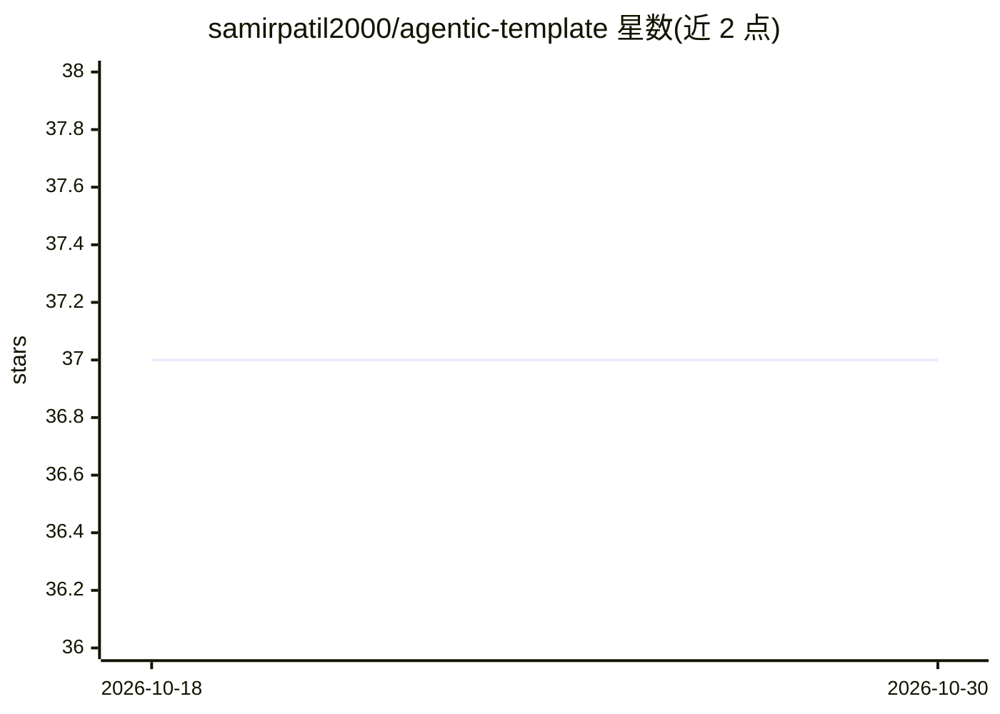

# samirpatil2000/agentic-template

⭐ 37 · Python · 推送 2026-06-02 · [GitHub](https://github.com/samirpatil2000/agentic-template) · 个人维护

**面向开发者的 FastAPI + LangGraph AI 工作流编排模板**

用于构建 AI 工作流编排系统的起步模板：以 FastAPI 提供 REST 端点（启动、继续、查询工作流），以 LangGraph 编排 AI Agent 工作流，内置状态管理与检查点、PostgreSQL 持久化、工作流中断与续跑、ThreadPoolExecutor 并发执行。附带 LiteLLM 的 LLM 响应校验与重试工具、langfuse 观测追踪，以及 JSON/简洁双模式的日志体系（20MB 轮转）。需要 Python 3.11+ 与 PostgreSQL，通过 git clone 与 pip 安装依赖运行。

## 筛选速览

| 维度 | 判定 | 备注 |
|---|---|---|
| AI 角色 | `ai-ecosystem` | LLM/agent 周边工具 |
| 许可风险 | `none` | — |
| 部署形态 | `library` | 以包/库形式分发 |
| 模型依赖 | — | README 未给出锁定关系 |
| 硬件要求 | — | 无带数字的原话,不猜 |
| 安装摩擦 | `low` | 无编译、无系统依赖或容器化 |
| 成熟度 | — | 结构信号不足 |

## 能力要点

- LangGraph 编排 + FastAPI REST 端点的工作流启动/继续/查询
- PostgreSQL 持久化、检查点与工作流中断续跑
- LiteLLM 集成的 LLM 响应校验与重试工具
- langfuse 观测追踪与结构化 JSON 日志（20MB 轮转）

## 适用场景

- 快速搭建带 REST API 的 AI Agent 工作流后端原型
- 需要持久化与中断续跑的多步骤 LLM 工作流开发
- 为自研业务定制替换示例工作流与模型配置

## 场景标签

`Agent 框架` · 领域:Agent 开发

## 证据(README 行号)

> L1: # FastAPI + LangGraph Workflow Orchestration Template Ask DeepWiki
> L3: A starter template for building AI-driven workflow orchestration systems using FastAPI and LangGraph. This project p
> L8: - LangGraph integration for AI workflow orchestration

## 星数曲线

2026-10-18 37 → 2026-10-30 37（+0）

---
*卡片 v1 · prompt 1.4 · 生成 2026-10-25 · 置信度 mid · 依据 README sha `4b5f5d6c1400` · [字段定义](../../DATASET.md)*
