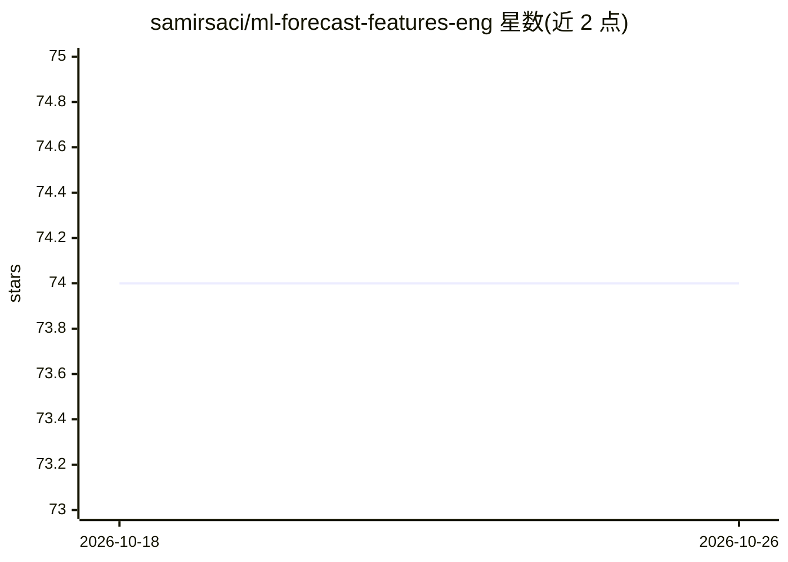

# samirsaci/ml-forecast-features-eng

⭐ 74 · Jupyter Notebook · 推送 2026-09-17 · [GitHub](https://github.com/samirsaci/ml-forecast-features-eng) · [官网](https://www.samirsaci.com/machine-learning-for-retail-sales-forecasting-features-engineering/) · 个人维护

**零售销量预测的特征工程分析 Jupyter 教程**

由供应链工程师 Samir Saci 提供的 Jupyter Notebook 项目：基于 M5 Forecasting（沃尔玛门店销售记录）数据集，实验库存缺货、门店闭店日期、蚕食效应等额外特征对机器学习销量预测模型准确度的影响。使用方式为本地创建 Data 文件夹、下载 Kaggle 比赛数据后运行 notebook。配套 Medium 文章说明代码背后的推理，作者另维护 Supply Science 教学应用与 100+ 案例源码。

## 筛选速览

| 维度 | 判定 | 备注 |
|---|---|---|
| AI 角色 | `ai-native` | 本体是模型或模型工具 |
| 许可风险 | `none` | — |
| 部署形态 | `None` |  |
| 模型依赖 | — | README 未给出锁定关系 |
| 硬件要求 | — | 无带数字的原话,不猜 |
| 安装摩擦 | `low` | 无编译、无系统依赖或容器化 |
| 成熟度 | — | 结构信号不足 |

## 能力要点

- 基于 M5 Forecasting 沃尔玛销售数据集的实验
- 考察缺货/闭店/蚕食等业务特征对预测准确度的影响
- 配套 Medium 文章说明特征构建思路

## 适用场景

- 学习为销量预测模型设计业务特征
- 复现 M5 数据集上的特征工程实验
- 供应链分析入门参考案例

## 场景标签

`教程课程` · 领域:学习与行业

## 证据(README 行号)

> L21: In this Article, we examine the impact of several features on model accuracy using the M5 Forecasting competition d
> L35: This analysis will be based on the M5 Forecasting dataset of Walmart store sales records (Link).

## 星数曲线

2026-10-18 74 → 2026-10-26 74（+0）

---
*卡片 v1 · prompt 1.4 · 生成 2026-10-24 · 置信度 high · 依据 README sha `7579953428df` · [字段定义](../../DATASET.md)*
