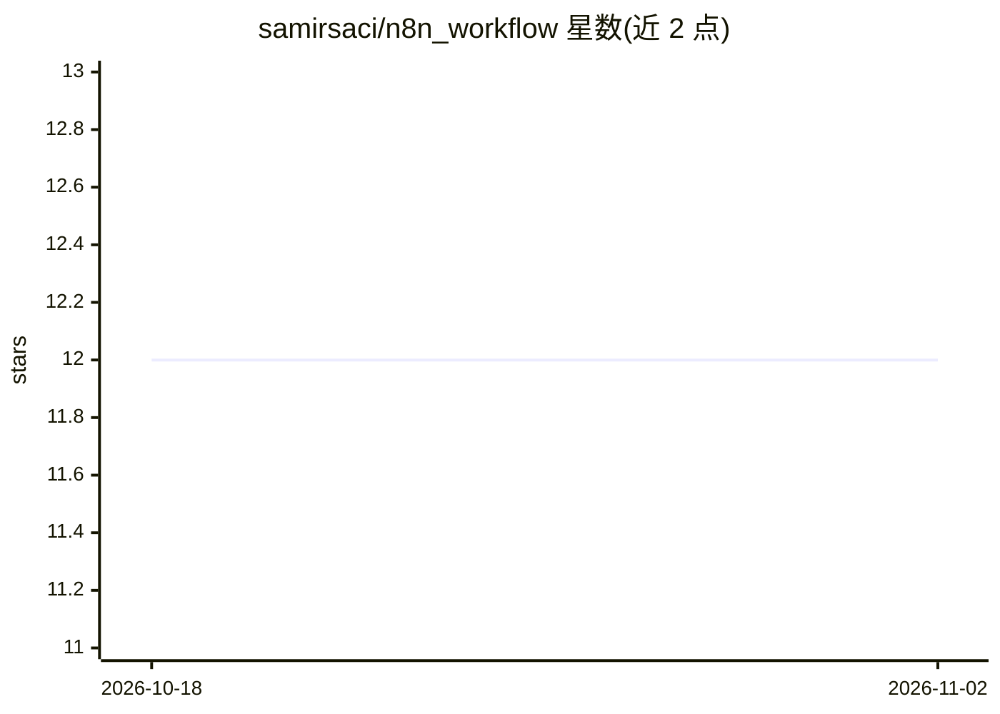

# samirsaci/n8n_workflow

⭐ 12 · 推送 2026-09-23 · [GitHub](https://github.com/samirsaci/n8n_workflow) · [官网](https://www.samirsaci.com/n8n/) · 个人维护

**n8n 工作流合集：供应链与可持续性自动化教程配套 JSON 模板**

由 Supply Science 频道作者 Samir Saci 维护的 n8n 工作流集合：每个工作流独立文件夹，含可直接导入 n8n 的 workflow.json 与带设置说明的 README，并配有 YouTube 视频教程。内容按五大类组织——商业/学生生产力、内容创作营销、可持续性、物流与供应链自动化、编程与 DevOps，覆盖 EDI 解析、库存循环盘点、运输订单管理、CO2 排放计算等场景，大量工作流结合 GPT-4o、Telegram、Google Sheets 等服务。面向使用 n8n 的自动化实践者，按文件夹索引导航。

## 筛选速览

| 维度 | 判定 | 备注 |
|---|---|---|
| AI 角色 | `ai-knowledge` | 知识聚合/清单类 |
| 许可风险 | `permissive` | — |
| 部署形态 | `None` |  |
| 模型依赖 | — | README 未给出锁定关系 |
| 硬件要求 | — | 无带数字的原话,不猜 |
| 安装摩擦 | `low` | 无编译、无系统依赖或容器化 |
| 成熟度 | — | 结构信号不足 |

## 能力要点

- 每个工作流含可直接导入 n8n 的 JSON 导出文件
- 五大类组织：生产力/内容创作/可持续性/物流供应链/DevOps
- 多个工作流配备 YouTube 视频教程讲解

## 适用场景

- 找到供应链与物流自动化的现成 n8n 模板直接导入使用
- 学习 GPT-4o 等 LLM 节点在自动化工作流中的接法
- 参考可持续性报告审计、EDI 解析等场景的实现方式

## 场景标签

`工作流自动化` `教程课程` · 领域:效率与自动化

## 证据(README 行号)

> L8: A curated collection of **production-ready n8n workflows** used across real supply-chain, sustainability, and busine
> L20: - **Ready to deploy** (JSON export included)

## 星数曲线

2026-10-18 12 → 2026-11-02 12（+0）

---
*卡片 v1 · prompt 1.4 · 生成 2026-11-01 · 置信度 high · 依据 README sha `37edb2148e18` · [字段定义](../../DATASET.md)*
