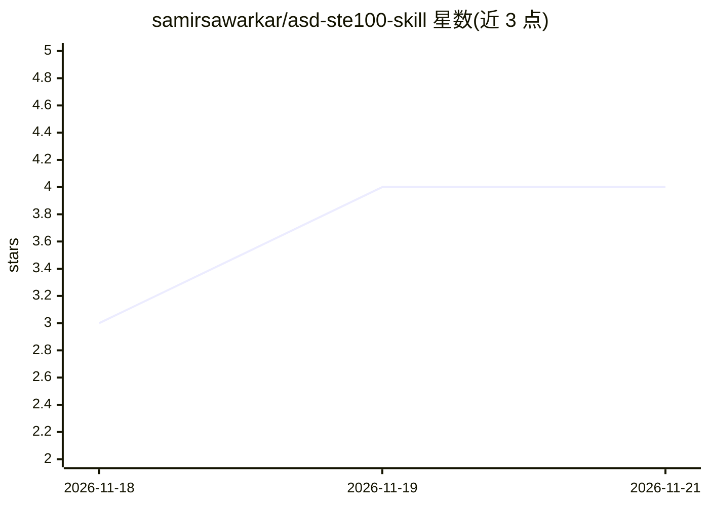

# samirsawarkar/asd-ste100-skill

⭐ — · [GitHub]() · 个人维护

**给 Claude Code/Codex 用户的 ASD-STE100 简化英语技能与提示词编译器**

面向 Claude Code、OpenAI Codex、ChatGPT 等 AI 助手的开源 Agent Skill 与提示词编译器，实现 ASD-STE100 简化技术英语规范和 Karpathy 的理解阶梯（受控写作→Mermaid/SVG 图表→单文件交互 HTML→Manim+TTS 讲解视频）。附带的 compile_prompt.py 脚本可将普通提示词编译为四层提示包，并内置 STE-100 linter 检查文本的未批准词与动词形态。零第三方依赖，通过 skills.sh CLI、git clone 或 symlink 安装到全局/项目技能目录。

## 筛选速览

| 维度 | 判定 | 备注 |
|---|---|---|
| AI 角色 | `ai-ecosystem` | LLM/agent 周边工具 |
| 许可风险 | `permissive` | — |
| 部署形态 | `library` | 以包/库形式分发 |
| 模型依赖 | — | README 未给出锁定关系 |
| 硬件要求 | — | 无带数字的原话,不猜 |
| 安装摩擦 | `low` | 无编译、无系统依赖或容器化 |
| 成熟度 | — | 结构信号不足 |

## 能力要点

- 实现 ASD-STE100 简化英语规范：句长、动词形态、词汇替换等硬性约束
- 四层输出阶梯：受控写作、Mermaid/SVG 图表、交互 HTML、Manim+TTS 讲解视频
- 内置 STE-100 linter，输出评分与逐条违规报告
- 零依赖 Python 提示词编译器与 assert 测试套件

## 适用场景

- 让 LLM 以 ASD-STE100 受控语言撰写或改写技术文档
- 审计现有文本是否符合 STE-100 规范
- 按 Karpathy 阶梯生成图表、交互页面或讲解视频形式的解释内容

## 场景标签

`提示工程` · 领域:Agent 开发

## 证据(README 行号)

> L9: An open-source Agent Skill and Prompt Compiler for **Claude Code**, **OpenAI Codex**, **ChatGPT**, and modern AI ass
> L101: ### 1. Compile Normal Prompts to Karpathy-Tier Prompts

## 星数曲线

2026-11-18 3 → 2026-11-21 4（+1）

---
*卡片 v1 · prompt 1.4 · 生成 2026-11-21 · 置信度 mid · 依据 README sha `57dcc4b2bd22` · [字段定义](../../DATASET.md)*
