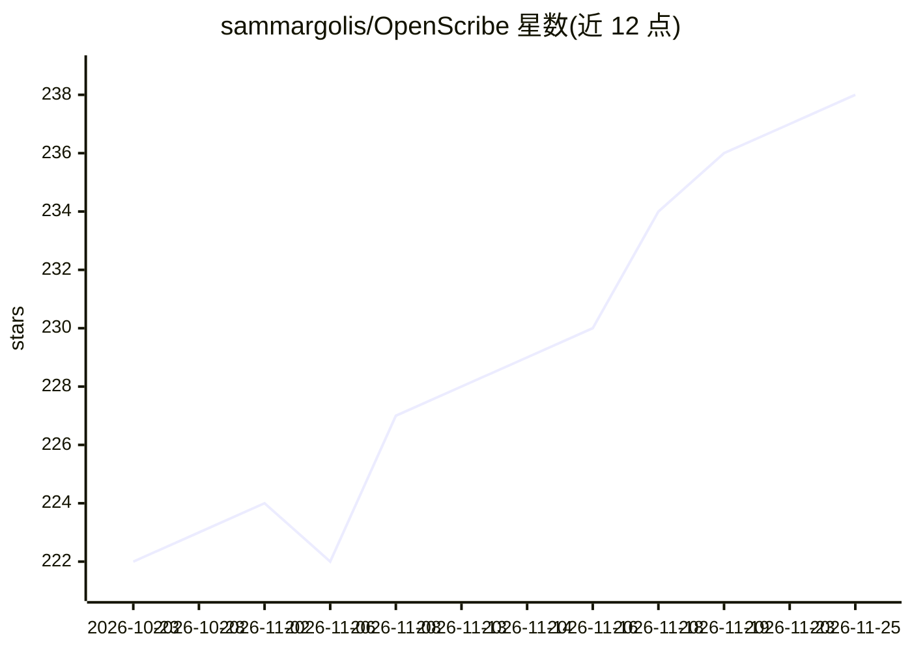

# sammargolis/OpenScribe

⭐ 238 · TypeScript · MIT · 推送 2026-10-29 · [GitHub](https://github.com/sammargolis/OpenScribe) · [官网](https://openscribe.org) · 个人维护

**给临床医生的录音转结构化病历开源工具**

开源 AI 医疗记录工具，录制问诊音频后经 Whisper 转录、由 LLM 生成结构化临床笔记草稿，支持 Default/SOAP/自定义 Markdown 模板。默认为混合模式（本地 Whisper 转录 + Anthropic Claude 生成笔记），另有完全本地桌面路径（Whisper + Ollama）与云 API 回退路径。数据以 AES-GCM 加密存储在浏览器本地，无遥测。当前尚未达到 HIPAA 合规，AI 笔记均为需人工审核的草稿。

## 筛选速览

| 维度 | 判定 | 备注 |
|---|---|---|
| AI 角色 | `ai-native` | 本体是模型或模型工具 |
| 许可风险 | `permissive` | MIT |
| 部署形态 | `self-host` | docker 或自建部署 |
| 模型依赖 | local-ok | 支持本地模型 |
| 硬件要求 | — | 无带数字的原话,不猜 |
| 安装摩擦 | `low` | 无编译、无系统依赖或容器化 |
| 成熟度 | `idea` | |

## 能力要点

- 三种运行模式：混合 Web（默认）、全本地桌面、云 API 回退
- 本地 Whisper 转录支持多语言与界面内语言选择
- 笔记模板支持 Default/SOAP/自定义 Markdown 结构
- AES-GCM 加密本地存储，零遥测与云同步

## 适用场景

- 门诊问诊后自动生成结构化病历草稿
- 在网络受限环境用全本地路径（Whisper+Ollama）生成笔记
- 按科室定制自定义笔记模板并填充转录内容

## 场景标签

`语音识别` · 领域:感知与多模态

## 证据(README 行号)

> L21: OpenScribe is a free, MIT-licensed, open-source AI medical scribe that helps clinicians record patient encounters, 
> L156: ### Mixed Web (default)
> L318: - **Transcription (default web path)**: local Whisper server (`whisper.cpp` via `pywhispercpp`, model `tiny.en`)

## 星数曲线

2026-10-23 222 → 2026-11-25 238（+16）

---
*卡片 v1 · prompt 1.4 · 生成 2026-11-25 · 置信度 high · 依据 README sha `fe13e1938ea8` · [字段定义](../../DATASET.md)*
