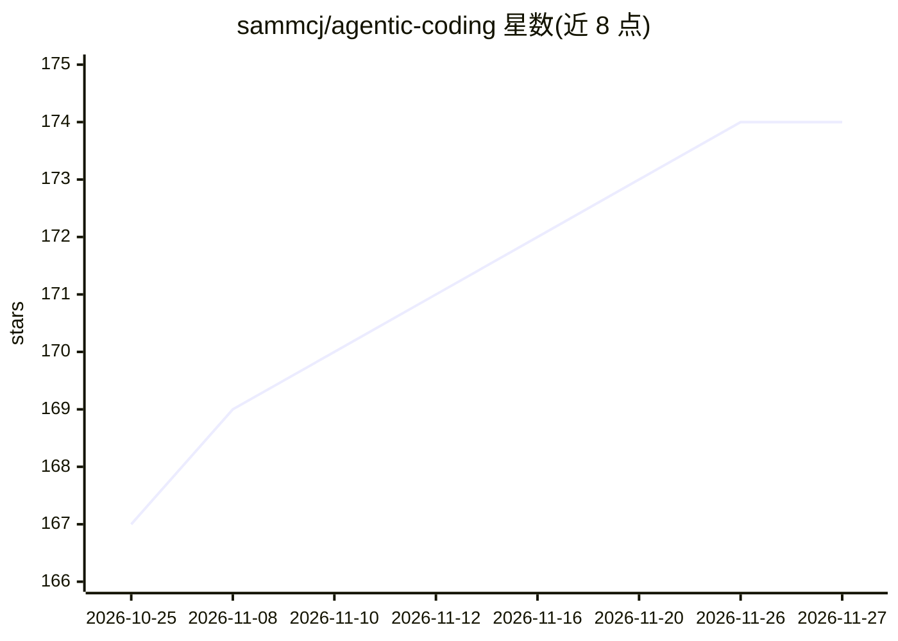

# sammcj/agentic-coding

⭐ 174 · Python · Apache-2.0 · 推送 2026-11-26 · [GitHub](https://github.com/sammcj/agentic-coding) · [官网](https://smcleod.net) · 个人维护

**面向开发者的 agentic coding 规则、技能与模板集**

作者整理的个人 agentic coding 资产库：包含 Agent Skills（可组合技能）、自定义 agent 定义、CLAUDE.md 等规则文件、prompt 模板命令，以及本地 Claude Code 插件 marketplace（含 LSP 定义）。内容以工具无关方式组织，作者声明多数技能与规则可在不同 agentic coding 工具间移植。另附使用技巧（权限预批、沙箱运行、上下文管理、fresh session 策略）与订阅制/按量计费 provider 的成本说明，采用 Apache 2.0 许可。

## 筛选速览

| 维度 | 判定 | 备注 |
|---|---|---|
| AI 角色 | `ai-knowledge` | 知识聚合/清单类 |
| 许可风险 | `permissive` | Apache-2.0 |
| 部署形态 | `None` |  |
| 模型依赖 | — | README 未给出锁定关系 |
| 硬件要求 | — | 无带数字的原话,不猜 |
| 安装摩擦 | `low` | 无编译、无系统依赖或容器化 |
| 成熟度 | — | 结构信号不足 |

## 能力要点

- 工具无关组织的规则、技能、命令模板集合
- 本地 Claude Code marketplace 插件（含 LSP 定义）
- 提供 systematic-debugging 等技能与权限/沙箱配置建议
- 订阅制与按量计费 provider 的成本对比说明

## 适用场景

- 为 Claude Code 等 agent 工具复用现成的规则与技能模板
- 参考 agent 权限、沙箱与上下文管理实践
- 为团队建立 agentic coding 的 Setup→Plan→Act→Review 流程

## 场景标签

`提示工程` · 领域:Agent 开发

## 证据(README 行号)

> L5: My Agent Skills, Agent Rules for Agentic Coding.
> L9: The repository is organised with tool-agnostic content at the root level:

## 星数曲线

2026-10-25 167 → 2026-11-27 174（+7）

---
*卡片 v1 · prompt 1.4 · 生成 2026-11-26 · 置信度 high · 依据 README sha `dbcb5dffbc9e` · [字段定义](../../DATASET.md)*
