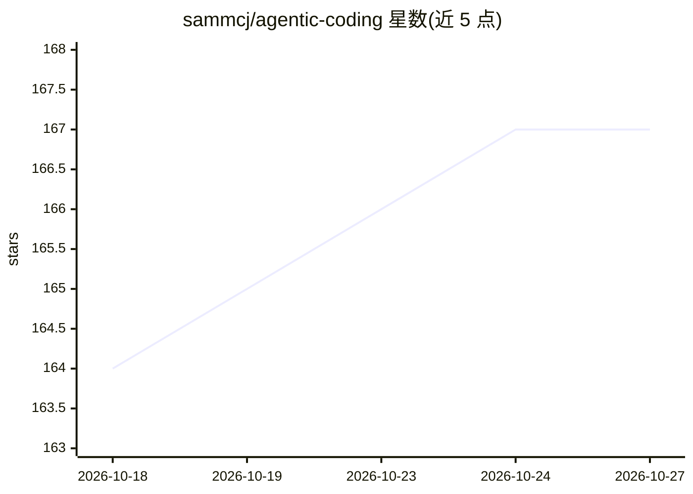

# sammcj/agentic-coding

⭐ 167 · Python · Apache-2.0 · 推送 2026-10-26 · [GitHub](https://github.com/sammcj/agentic-coding) · [官网](https://smcleod.net) · 个人维护

**agentic 编程的规则、技能与模板合集，供编码 agent 复用**

个人维护的 agentic 编程资源仓库，收录可组合的 Agent Skills、自定义 Agent、Agent 指令规则文件（以 CLAUDE.md 为主）、提示模板以及 Claude Code 本地插件市场（含 LSP 定义）。内容按工具无关方式组织于根目录，声明多数技能与规则可在不同 agentic 编程工具间移植。README 另包含 agentic 编程实践建议、第三方插件推荐（如 cc-safety-net、context-mode、Graphify）与订阅/按量付费服务的费用讨论。仓库以 Apache 2.0 许可发布。

## 筛选速览

| 维度 | 判定 | 备注 |
|---|---|---|
| AI 角色 | `ai-knowledge` | 知识聚合/清单类 |
| 许可风险 | `permissive` | Apache-2.0 |
| 部署形态 | `None` |  |
| 模型依赖 | — | README 未给出锁定关系 |
| 硬件要求 | — | 无带数字的原话,不猜 |
| 安装摩擦 | `low` | 无编译、无系统依赖或容器化 |
| 成熟度 | — | 结构信号不足 |

## 能力要点

- 按工具无关方式组织的 Agent Skills / Rules / Commands 模板
- Claude Code 本地插件市场（含 LSP 定义）
- 声明多数技能与规则可在 agentic 编程工具间移植
- 包含 agentic 编程最佳实践与上下文工程建议

## 适用场景

- 为编码 agent 配置可复用的规则与技能
- 参考 agentic 编程的上下文工程与调试实践
- 挑选适配 Claude Code / Cline 等工具的提示模板

## 场景标签

`提示工程` `精选清单` · 领域:Agent 开发

## 证据(README 行号)

> L11: - Agent Skills - Composable skills that extend agent capabilities
> L14:  - Rules/CLAUDE.md is usually the most up to date and comprehensive
> L18: Most skills and rules are reasonably portable between agentic coding tools.

## 星数曲线

2026-10-18 164 → 2026-10-27 167（+3）

---
*卡片 v1 · prompt 1.4 · 生成 2026-10-22 · 置信度 high · 依据 README sha `88778ad34d85` · [字段定义](../../DATASET.md)*
